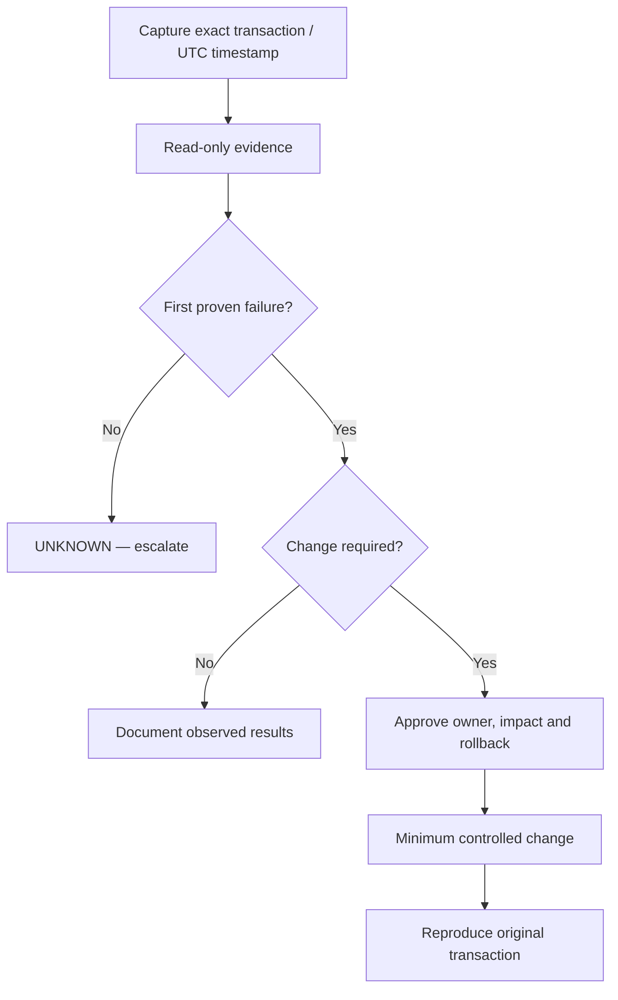

<div class="sop-page" markdown="1">

<div class="sop-banner" role="region" aria-label="Controlled SOP header">
  <div class="sop-brand"><span class="sop-mark">RHOSO</span><small>Red Hat OpenStack<br>Services on OpenShift</small></div>
  <div class="sop-banner-name"><strong>STANDARD OPERATING PROCEDURE (SOP)</strong><span>[Procedure title]</span></div>
</div>

# [Procedure title]

| Document reference | RHOSO-ITD-SOP-[AREA]-[NNN] | Revision | REV. 00.0 |
| --- | --- | --- | --- |
| Effective date | Pending approval | Status | **DRAFT — UNAPPROVED** |
| Target platform | RHOSO 18.x — exact micro-release unverified | Classification | Public engineering draft |

!!! danger "Release restriction"
    **DRAFT / not authorized for live production changes.** Read-only discovery is for appropriately authorized personnel. Follow the [release gate](RELEASE-GATE.md) before promoting status.

## DOCUMENT INFORMATION

| Field | Value | Field | Value |
| --- | --- | --- | --- |
| Department | [Actual IT department / unit] | Document custodian | [Role] |
| Document developer | [Name and designation] | Signature / date | Pending / Pending |
| Target release | [Exact RHOSO / OCP / EDPM versions] | Change reference | [Not assigned] |

## DOCUMENT REVIEW AND APPROVAL

| Action | Name | Title / responsibility | Business unit | Signature | Date |
| --- | --- | --- | --- | --- | --- |
| Reviewed by | Pending | [RHOSO Technical Reviewer] | [Unit] | Pending | Pending |
| Reviewed by | Pending | [IT Operations Reviewer] | [Unit] | Pending | Pending |
| Approved by | Pending | [Authorized Approver] | [Unit] | Pending | Pending |

<div class="sop-public-notice"><strong>Publication notice.</strong> This repository is publicly accessible. Do not include organization-confidential language copied from other institutions, internal endpoints, credentials, customer data, tenant information or production evidence. Any controlled confidential version must be published via the organization's approved private document-management process.</div>

## REVISION HISTORY

| Revision | Date (UTC) | Justification | Sections revised |
| --- | --- | --- | --- |
| REV. 00.0 | [Date] | Initial draft | N/A |

## TABLE OF CONTENTS

| Section | Content | Section | Content |
| --- | --- | --- | --- |
| 1 | [Purpose](#1-purpose) | 6 | [Implementation](#6-implementation) |
| 2 | [Scope](#2-scope) | 7 | [Review requirements](#7-review-requirements) |
| 3 | [Applicability](#3-applicability) | 8 | [References](#8-references) |
| 4 | [Terms & definitions](#4-terms-definitions) | 9 | [Appendices](#9-appendices) |
| 5 | [Roles & responsibilities](#5-roles-responsibilities) | | |

## 1 PURPOSE

[Identify exact user-visible transaction or scheduled operational objective and measurable result.]

## 2 SCOPE

[Specify included services, cells, roles, environments, supported topology and explicit exclusions.]

## 3 APPLICABILITY

[State RHOSO/OCP version, optional service dependencies and L1/L2/L3 authority.]

## 4 TERMS & DEFINITIONS

| No. | Term | Definition |
| --- | --- | --- |
| 1 | RHOSO | Red Hat OpenStack Services on OpenShift |
| 2 | [Term] | [Definition] |

## 5 ROLES & RESPONSIBILITIES

| No. | Responsible party | Role and responsibilities |
| --- | --- | --- |
| 1 | L1 Operations | Authorized read-only evidence collection and escalation |
| 2 | L2 RHOSO Engineer | Fault-domain diagnosis, approved service-specific change execution |
| 3 | L3 / Owner | Architecture, safety gates, root-cause approval and escalation |

## 6 IMPLEMENTATION

### 6.1 Prerequisites and authorization

- [Identity, target cloud, release compatibility, source-of-truth controller, incident/change ticket.]
- [Do not assume namespaces/pod/container names. Confirm approved authorization before executing writes.]

### 6.2 Impact, risk and stop conditions

!!! danger "STOP"
    [First proven failure is not identified; unclear controller ownership; missing permissions; unacceptable impact; rollback unavailable.]

### 6.3 Decision flow



### 6.4 Execution procedure

**Step 1 — Read-only discovery [OCP].**

```bash
oc whoami
oc get openstackcontrolplanes -A
```

**Expected:** actual cloud/namespace discovered. **Stop:** ambiguous scope or unauthorized access.

**Step 2 — Read-only transaction check [OS].** Use authenticated, discovered OpenStackClient context.

```bash
openstack token issue -f value -c expires
```

**Expected:** Keystone token metadata only; this does not prove downstream service health.

**Step 3 — Change control (only if applicable).** [Site-verified exact approved commands, expected results, stop conditions and owner.]

### 6.5 Acceptance and validation

[Reproduce original failing user/system transaction; log expected vs observed results, UTC timestamp and request ID. Do not consider pod Running or HTTP 200 as end-to-end validation.]

### 6.6 Rollback or restoration

[Minimum safe site-verified rollback, impact and verification, or "not applicable — read-only SOP".]

### 6.7 Evidence handling and escalation

- **PROVEN HEALTHY:** [Verified passed transaction stage]
- **PROVEN BROKEN:** [First correlated failed transaction stage]
- **INFERENCE:** [Interpretation supported by evidence]
- **HYPOTHESIS:** [Candidate cause without proof]
- **UNKNOWN:** [Missing test/data, unavailable dependency]
- **Escalation:** [Owning L2/L3 team and ticket reference]

## 7 REVIEW REQUIREMENTS

Annual and event-driven reviews are mandatory when RHOSO/OpenShift versions, topology, policies or service ownership change. All revisions require document control and technical review. GitHub merge / CI PASS does not constitute live-runbook approval.

## 8 REFERENCES

- [RHOSO 18.0 documentation](https://docs.redhat.com/en/documentation/red_hat_openstack_services_on_openshift/18.0)
- [Platform compatibility](COMPATIBILITY.md)
- [L1/L2/L3 escalation](START-HERE.md)
- [Production release gate](RELEASE-GATE.md)

## 9 APPENDICES

### Appendix A — Evidence register

| Evidence | Approved record location |
| --- | --- |
| Ticket, UTC time, original user transaction | [Secure ITSM reference] |
| First proven failure | [Short, redacted source excerpt] |
| Validation / rollback | [Acceptance test and approved rollback evidence] |

### Appendix B — Worked example

[Link the relevant SOP-specific worked example. Mark fictional observations SIMULATED.]

<div class="sop-paper-footer"><span>RHOSO · Engineering DRAFT · Public reference</span><span>RHOSO-ITD-SOP-[AREA]-[NNN] · REV. 00.0</span></div>

</div>
