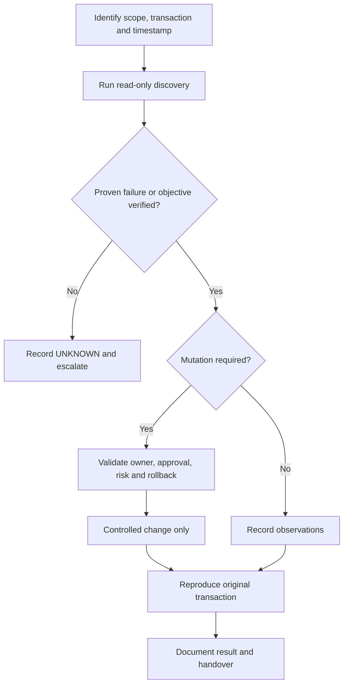

# SOP-INC-001 · Investigate VM Stuck in BUILD / ERROR

> [!WARNING]
> **DRAFT — NOT APPROVED FOR LIVE PRODUCTION.** Release-dependent commands require target-environment verification. **No production execution has been performed.**

| Document control | Value | Document control | Value |
| :--- | :--- | :--- | :--- |
| **SOP ID** | SOP-INC-001 | **Version** | 0.2.0 |
| **Status** | DRAFT | **Type** | incidents |
| **Release** | RHOSO 18.x (micro-release unverified) | **Owner / Approver** | Not assigned |
| **Last live validation** | Not performed | **Execution** | [OCP] / [OS] as marked |
| **Change reference** | Required for any write | **Authoritative owner** | Discover Operator / GitOps / Helm |

**Quick navigation:** [Purpose](#1-purpose) · [Scope](#2-scope) · [Prerequisites](#3-prerequisites) · [Risks](#4-impact-and-risks) · [Flow](#5-decision-path) · [Steps](#6-detailed-procedure) · [Validation](#7-validation) · [Rollback](#8-rollback--recovery) · [Troubleshooting](#9-troubleshooting-and-escalation) · [References](#10-references) · [History](#11-revision-history)

## 1. Purpose

Trace a particular instance creation request to the first provably failed Nova, Placement, Neutron, Cinder/Glance or EDPM transaction.

**Expected operational outcome:** Locate matching request ID, timestamp and first failing subsystem; after an independently approved fix, reproduce the original VM create transaction.

## 2. Scope

RHOSO 18.x only with deployed, supported components. Reference names and namespaces are **not** assumed. See the site-specific support matrix before performing changes.

## 3. Prerequisites

Authenticated [OCP] OpenShift workstation and discovered [OS] OpenStackClient when needed; least-privilege credentials; correct cloud/project/region/host; incident or approved change ticket; known authoritative owner.

## 4. Impact and risks

> [!CAUTION]
> Read-only diagnosis; no retry/delete/rebuild/restart from BUILD or ERROR alone. **STOP** if the original transaction, command context, controller ownership, prerequisites or rollback capability is unknown.

## 5. Decision path

## 6. Detailed procedure

| Step | Description | Exact command and context | Expected result | Interpretation / stop |
| :--- | :--- | :--- | :--- | :--- |
| 1 | Identify instance | `[OS] openstack server show "$VM_UUID" -f yaml` | Exact fault/status and instance ID | Status is symptom, not cause |
| 2 | Read instance events | `[OS] openstack server event list "$VM_UUID"` | Timestamped actions; request linkage if available | Use earliest matching failure |
| 3 | Inspect service inventory | `[OS] openstack compute service list` | Compute up/down and enabled flags | Not proof of Placement eligibility |
| 4 | Correlate logs | `[OCP] oc logs -n "$RHOSO_NAMESPACE" "$NOVA_POD" -c "$NOVA_CONTAINER" --timestamps --since=60m` | Matching request ID or instance at incident time | Escalate to first failing fault domain |

> [!NOTE]
> Run commands **individually in their stated execution context**. Substitute real discovered values. The matrix above is a reference; do not execute a table directly.

### Full procedure and environment discovery

| Field | Value |
| --- | --- |
| Status / version | DRAFT / 0.1.0 |
| Scope | RHOSO 18.x; Nova -> Placement -> Neutron -> Cinder/Glance -> EDPM compute |
| Execution | [OS] authenticated OpenStackClient; [OCP] control-plane shell |
| Owner / approver | To be assigned |
| Last site validation | Not performed |

## Transaction boundary

**Original transaction:** tenant requests server creation; Nova returns a server ID, then the instance remains BUILD or reaches ERROR. A successful create API response proves only request acceptance, not scheduling, port binding, image retrieval, block-device mapping, or VM boot.

Record project, region, request ID, instance UUID, client-side timestamp, observed state and which dependency was first to fail. Distinguish incident-time state from current condition.

## Read-only collector

Use discovered, authorized contexts; do not paste multiple contexts into one shell. Variables below must be supplied from ticket/CLI evidence, not guessed.

~~~bash
# [OCP][RO] Discover RHOSO namespaces and client/service pods.
oc get openstackcontrolplanes -A
oc get pods -A -o wide | grep -Ei 'openstackclient|nova|placement|neutron|cinder|glance'

# [OCP][RO] Use the discovered namespace/pod.
oc rsh -n "$RHOSO_NAMESPACE" "$CLIENT_POD"

# [OS][RO] Verify cloud identity and the exact failing VM.
openstack token issue
openstack server show "$VM_UUID" -f yaml

# [OS][RO] Retrieve instance actions and inventory without mutation.
openstack server event list "$VM_UUID"
openstack server list --all-projects --long
openstack compute service list
openstack hypervisor stats show
openstack resource provider list

# [OS][RO] Inspect related Neutron and block storage dependencies.
openstack port list --server "$VM_UUID"
openstack server volume list "$VM_UUID"
openstack image list --long

# [OCP][RO] Discover exact scheduler/conductor pod and its containers.
oc get pods -n "$RHOSO_NAMESPACE" -o wide
oc get pod -n "$RHOSO_NAMESPACE" "$NOVA_POD" -o jsonpath='{.spec.containers[*].name}'

# [OCP][RO] Correlate request ID and timestamp within the discovered container.
oc logs -n "$RHOSO_NAMESPACE" "$NOVA_POD" -c "$NOVA_CONTAINER" --timestamps --since=60m
~~~

## Evidence classification

- **PROVEN HEALTHY**: exact prior transaction stage completes successfully with matching request/instance ID.
- **PROVEN BROKEN**: earliest error in scheduler, conductor, Placement allocation, image fetch, port binding, volume mapping or compute host at incident time.
- **INFERENCE / HYPOTHESIS**: NoValidHost may indicate capacity, aggregate/AZ rules, flavor traits, PCI/NUMA, cell mapping or service state; it is not the root cause without matching evidence.
- **UNKNOWN**: missing trace, absent logs, RBAC gap or unsupported/disabled optional service.

## Fault-domain-specific next action

- Scheduler rejection: collect scheduler error and Placement provider inventory/traits/allocations; inspect requested flavor, AZ and aggregates.
- Compute unregistered/down: compare service list, hypervisors, cell host mappings (use discovered Nova conductor as described in [Nova reference](https://github.com/sheejithkv/RHOSO/blob/main/docs/05-nova-cells-compute-placement.md)) and EDPM nova-compute service logs.
- Port binding/DHCP: inspect the instance port and Neutron API errors; then OVN NB/SB binding and affected chassis, not the entire network stack by default.
- Image or volume error: trace matching Glance/Cinder request and backend logs before involving Ceph.

## Stop / remediation boundary

This SOP is intentionally read-only. **Do not retry server creation, delete a port/VM, change quotas, force service state, or restart Nova based solely on BUILD/ERROR.** Document controller ownership, first proven failure, minimal reviewed change, risk, rollback and the test that reproduces the **original VM provisioning transaction**. Escalate when evidence crosses into a different fault domain.

## 7. Validation

Locate matching request ID, timestamp and first failing subsystem; after an independently approved fix, reproduce the original VM create transaction. Record observed values, timestamp, request/VM/host reference, and explicit PASS / FAIL / UNAVAILABLE; a healthy Kubernetes object is not an end-to-end test.

## 8. Rollback / recovery

No change in this SOP. A separate approved remediation requires rollback with workload-specific safeguards.

## 9. Troubleshooting and escalation

Classify evidence into **PROVEN HEALTHY**, **PROVEN BROKEN**, **INFERENCE**, **HYPOTHESIS**, and **UNKNOWN**. Record the first proven boundary; do not infer trigger/root cause from labels without logs.

## 10. References

- [RHOSO 18.x admin command reference](https://github.com/sheejithkv/RHOSO/blob/main/docs/00-usage-and-conventions.md)
- [Official Red Hat sources](https://github.com/sheejithkv/RHOSO/blob/main/docs/official-sources.md)
- [Worked example for this area](EXAMPLE.md) (**SIMULATED**, not observed)

## 11. Revision history

| Version | Date (UTC) | Change | Site verification |
| :--- | :--- | :--- | :--- |
| 0.1.0 | 2026-10-20 | Starter draft | Not performed |
| 0.2.0 | 2026-10-21 | Visual SOP metadata, step/expected matrices and example links | Not performed |
