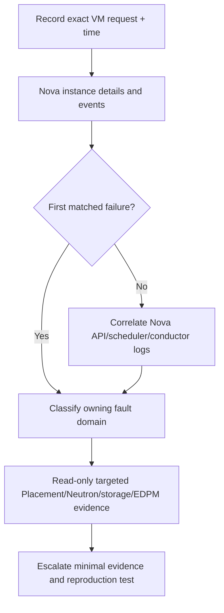

<div class="sop-page" markdown="1">

<div class="sop-banner" role="region" aria-label="Controlled SOP cover header">
  <div class="sop-brand"><span class="sop-mark">RHOSO</span><small>Red Hat OpenStack<br>Services on OpenShift</small></div>
  <div class="sop-banner-name"><strong>STANDARD OPERATING PROCEDURE (SOP)</strong><span>VM Provisioning Failure (BUILD / ERROR)</span></div>
</div>

# VM Provisioning Failure (BUILD / ERROR)

| Document reference | RHOSO-ITD-SOP-INC-001 | Revision | REV. 00.4 |
| --- | --- | --- | --- |
| Effective date | Pending approval | Status | **DRAFT — UNAPPROVED** |
| Target platform | RHOSO 18.x; micro-release not yet validated | Classification | **Public engineering draft** |

!!! danger "Operational release restriction"
    **DRAFT / NO-GO for unrestricted production use.** No named approver or site-specific execution validation exists. L1 only performs approved read-only steps. This public GitHub repository must not contain confidential incident details, credentials or organization-specific restricted material. See [release gate](../RELEASE-GATE.md).

## DOCUMENT INFORMATION

| Field | Value | Field | Value |
| --- | --- | --- | --- |
| Department | Information Technology — Cloud Platform Services *(confirm actual unit)* | Controlled document ID | RHOSO-ITD-SOP-INC-001 |
| Document developer | [Developer name / designation] | Signature / date | Pending / Pending |
| Release / applicability | RHOSO 18.x (site version verification required) | Document custodian | [Assigned role required] |

## DOCUMENT REVIEW AND APPROVAL

| Action | Name | Title / responsibility | Business unit | Signature | Date |
| --- | --- | --- | --- | --- | --- |
| Reviewed by | Pending | RHOSO Technical Lead (L2/L3) | Cloud Platform | Pending | Pending |
| Reviewed by | Pending | IT Operations Manager (L1) | IT Operations | Pending | Pending |
| Approved by | Pending | Authorized Platform / Change Approver | Information Technology | Pending | Pending |

<div class="sop-public-notice"><strong>Publication and confidentiality notice.</strong> This site is a public engineering reference. Do not add organization-confidential instructions, access data, tenant identifiers or internal endpoints. If the organization requires a confidential controlled copy, publish it through an authorized private document-management system using the organization's approved confidentiality notice.</div>

## REVISION HISTORY

| Revision | Revision date (UTC) | Revision justification | Sections revised |
| --- | --- | --- | --- |
| REV. 00.0 | 2026-10-20 | Initial engineering draft | N/A |
| REV. 00.3 | 2026-10-22 | Added operational safety, escalation and verification gates | Existing operational content |
| **REV. 00.4** | **2026-11-03** | Corporate controlled-document layout and formal nine-section structure | Front matter; 1–9 |

## TABLE OF CONTENTS

| Section | Content | Section | Content |
| --- | --- | --- | --- |
| 1 | [Purpose](#1-purpose) | 6 | [Implementation](#6-implementation) |
| 2 | [Scope](#2-scope) | 7 | [Review requirements](#7-review-requirements) |
| 3 | [Applicability](#3-applicability) | 8 | [References](#8-references) |
| 4 | [Terms & definitions](#4-terms-definitions) | 9 | [Appendices](#9-appendices) |
| 5 | [Roles & responsibilities](#5-roles-responsibilities) | | |

## 1 PURPOSE

Trace the **specific instance-create transaction** from API acceptance through scheduling, resource claims, networking and guest boot. BUILD/ERROR is a **symptom**, not root-cause evidence.

**Acceptance:** Identify the earliest error correlated to the same instance/request ID and UTC incident time. Remediation is in a separately approved fault-domain procedure; validate by reproducing the original server-create transaction.

## 2 SCOPE

Use OpenStack API and discovered RHOSO/EDPM service logs. Scope to the affected region, project, Nova cell and workload. Optional storage or networking services are investigated only where the transaction implicates them.

- **[OCP]** authenticated OpenShift administration workstation.
- **[OS]** authenticated, discovered OpenStackClient pod.
- **[EDPM]** approved RHEL data-plane host.
- **[POD]** discovered container in its actual namespace.

## 3 APPLICABILITY

Applies to authorized operations and incident responders at L1, L2 and L3 for production, staging, UAT and DR where a supported RHOSO 18.x deployment is documented. L1 performs evidence collection only; any modification requires a separately approved change.

**Document usage:** Incident / read-only investigation. The procedure's read-only versus change-controlled boundaries are normative; a merged documentation change does not authorize infrastructure modifications.

## 4 TERMS & DEFINITIONS

| No. | Term | Description |
| --- | --- | --- |
| 1 | RHOSO | Red Hat OpenStack Services on OpenShift. |
| 2 | Nova | OpenStack Compute service managing instance creation and lifecycle. |
| 3 | Placement | OpenStack resource inventories, allocation and candidate selection service. |
| 4 | EDPM | External Data Plane Management for RHOSO compute and data-plane services. |
| 5 | Instance UUID / Request ID | Identifiers used to correlate a specific VM and its associated API/service transaction. |
| 6 | BUILD / ERROR | Instance lifecycle states indicating provisioning is in progress or has failed; neither proves root cause. |

## 5 ROLES & RESPONSIBILITIES

| No. | Responsible party | Role and responsibilities |
| --- | --- | --- |
| 1 | Requesting / Application Team | Report failed instance, project, region, UTC timestamp, user-visible error and business impact. |
| 2 | L1 Operations | Confirm scope and ticket, collect read-only VM/events/status evidence, escalate without guessing the failing component. |
| 3 | L2 RHOSO Platform | Correlate Nova scheduler/conductor and implicated service evidence; establish first proven failing hop. |
| 4 | L3 / Architect / Change Authority | Review cross-domain cause, authoritative controllers, mitigation/rollback and approval of any mutating remediation. |

## 6 IMPLEMENTATION

Trace a specific server creation transaction across Nova, Placement, Neutron, Glance, Cinder and EDPM when evidence implicates those services.

### 6.1 Prerequisites and authorization

- Incident ticket with VM UUID, project, region, request ID (if available) and UTC time window.
- Discover RHOSO namespace and authorized OpenStackClient pod; confirm actual containers before logs.
- Confirm read-only access to affected Nova, Neutron and Placement APIs; document access gaps.

### 6.2 Impact, risk and stop conditions

!!! danger "STOP"
    No instance retry, rebuild, deletion, live migration, quota change, scheduler restart, or cell discovery based only on BUILD/ERROR. An unproven scheduler assumption must never drive a production change.

### 6.3 Decision flow



### 6.4 Execution procedure

**Step 1 — Discover execution environment [OCP, read-only].**

```bash
oc get openstackcontrolplanes -A
oc get pods -n "$RHOSO_NAMESPACE" -o wide
oc get pod -n "$RHOSO_NAMESPACE" "$NOVA_POD" -o jsonpath='{.spec.containers[*].name}'
```

**Expected:** real namespace, Nova scheduler/conductor/API pod name and chosen container are identified; no pod names are invented. Set `RHOSO_NAMESPACE`, `NOVA_POD`, and `NOVA_CONTAINER` from this discovery.

**Step 2 — Run OpenStack commands **inside the discovered authenticated OpenStackClient** [OS, read-only]. Use an authorized session, not the OpenShift workstation shell.

```bash
openstack token issue -f value -c expires
openstack server show "$VM_UUID" -f yaml
openstack server event list "$VM_UUID"
openstack port list --server "$VM_UUID"
openstack server volume list "$VM_UUID"
```

**Expected:** state, fault details and related resources for the **same VM UUID**. `event list` availability/visibility depends on installed client and RBAC. An API success does not prove guest boot.

**Step 3 — Inspect scheduler and compute eligibility [OS, read-only].**

```bash
openstack compute service list
openstack hypervisor stats show
openstack resource provider list
```

**Expected:** service state and capacity inventory. Aggregate capacity alone does not establish eligibility; compare the actual request's flavor, traits, AZ, NUMA and cell mappings.

**Step 4 — Correlate logs by exact request and time [OCP, read-only].**

```bash
oc logs -n "$RHOSO_NAMESPACE" "$NOVA_POD" -c "$NOVA_CONTAINER" --timestamps --since=60m
```

**Expected:** matching instance/request ID at the incident time. Set a different historical collection window if needed; absence of a matching line means UNKNOWN.

**Step 5 — Only follow the first proven failing hop.** If the matched failure is Neutron port binding, inspect that port and OVN binding; if Cinder mapping, inspect the specific volume transaction; if scheduling, inspect Placement allocations/inventories and Nova cell host mapping. Do **not** perform all tests without an evidenced need.

### 6.5 Acceptance and validation

After separate approved remediation, reproduce the original server-create request with equivalent region, flavor, network, storage constraints and project policy. Verify **ACTIVE**, actual compute placement, console/guest boot, intended ports and attached volumes. Record original and new request IDs; API acceptance alone is insufficient.

### 6.6 Rollback or restoration

Read-only SOP; none. Any proposed change must separately define authoritative owner, impact, explicit rollback steps and guest/storage consistency checks.

### 6.7 Evidence handling and escalation

**PROVEN BROKEN:** earliest correlated scheduler, port-binding, image, volume or compute error. **PROVEN HEALTHY:** successful prior stages matched to this request. **INFERENCE:** resulting inability to boot. **HYPOTHESIS:** NoValidHost caused by quota/traits/host capacity (unproven without inventories). **UNKNOWN:** missing logs, project visibility, or request ID.

Use [L1–L3 ownership and escalation](../START-HERE.md). Record incident-time and current-time evidence separately. A user-facing failure is not automatically proof of the ticket's assumed fault domain.

## 7 REVIEW REQUIREMENTS

This SOP shall be reviewed **at least annually**, when the deployed RHOSO micro-release or related Operators change, and after significant incidents, topology changes, or revised security and operational policies. The document developer updates the revision record; the RHOSO technical lead and IT Operations reviewer verify commands, scope, evidence, role boundaries and applicability before the designated approver authorizes its effective date.

Prior revisions must remain recoverable through Git history or the approved document-control system. An automated MkDocs build and Git merge **do not** constitute authorization for production execution.

## 8 REFERENCES

- [RHOSO official documentation](https://docs.redhat.com/en/documentation/red_hat_openstack_services_on_openshift/18.0)
- [RHOSO repository command reference](https://github.com/sheejithkv/RHOSO/tree/main/docs)
- [Worked incident example](EXAMPLE.md) — **SIMULATED**, not live evidence
- [Compatibility register](../COMPATIBILITY.md)

- [Red Hat RHOSO 18.0 documentation](https://docs.redhat.com/en/documentation/red_hat_openstack_services_on_openshift/18.0)
- [L1/L2/L3 escalation instructions](../START-HERE.md)
- [Release-specific compatibility register](../COMPATIBILITY.md)
- [Production release gate](../RELEASE-GATE.md)

## 9 APPENDICES

### Appendix A — Incident / change evidence register

| Evidence field | Record location |
| --- | --- |
| Ticket / change reference | [Approved ITSM ticket] |
| Cloud, region and UTC time | [Redacted secure evidence record] |
| Original transaction and observed failure | [Request ID / safe summary] |
| First proven failing boundary | [Short, timestamped redacted evidence] |
| Unknowns and escalation owner | [Named team or on-call queue] |
| Validation / rollback outcome | [Original transaction re-tested, or NOT VALIDATED] |

### Appendix B — Worked engineer example

See [the sample for this SOP](EXAMPLE.md). All illustrative outputs are **SIMULATED** and must never be presented as live RHOSO evidence.

<div class="sop-paper-footer"><span>RHOSO · Engineering DRAFT · Public reference</span><span>RHOSO-ITD-SOP-INC-001 · REV. 00.4</span></div>

</div>
