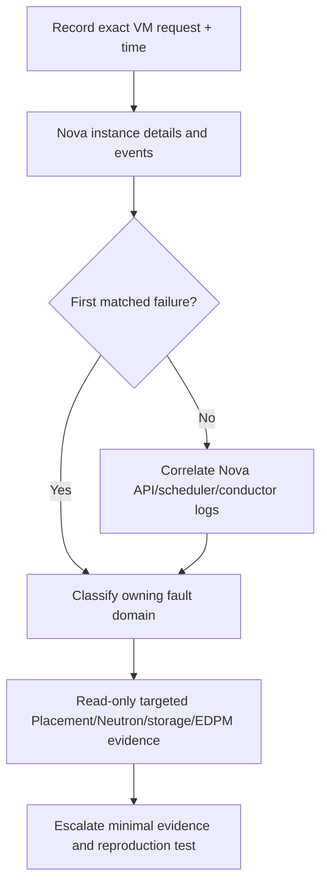

# SOP-INC-001 — VM stuck in BUILD or enters ERROR

!!! warning "DRAFT — engineering review only"
    **Not approved for production execution.** No site validation or named approver has been recorded. Confirm installed RHOSO micro-release, CR ownership, privileges, optional services and actual workload constraints. Follow [release gates](../RELEASE-GATE.md).

| Control | Value | Control | Value |
| --- | --- | --- | --- |
| SOP | SOP-INC-001 | Version | 0.3.0 |
| Status | **DRAFT** | Intended audience | L1 evidence; L2 Nova/Placement; L3 cross-domain |
| RHOSO applicability | **18.x — exact micro-release UNKNOWN** | Owner / approver | **Unassigned / unassigned** |
| Last live validation | **NOT PERFORMED** | Risk | Read-only diagnosis |
| Primary fault domain | Nova → Placement/Neutron/Glance/Cinder → EDPM | Change record | Not in this SOP |

## 1. Purpose and acceptance

Trace the **specific instance-create transaction** from API acceptance through scheduling, resource claims, networking and guest boot. BUILD/ERROR is a **symptom**, not root-cause evidence.

**Acceptance:** Identify the earliest error correlated to the same instance/request ID and UTC incident time. Remediation is in a separately approved fault-domain procedure; validate by reproducing the original server-create transaction.

## 2. Scope and execution contexts

Use OpenStack API and discovered RHOSO/EDPM service logs. Scope to the affected region, project, Nova cell and workload. Optional storage or networking services are investigated only where the transaction implicates them.

- **[OCP]** authenticated OpenShift administration workstation.
- **[OS]** authenticated, discovered OpenStackClient pod.
- **[EDPM]** approved RHEL data-plane host.
- **[POD]** discovered container in its actual namespace.

## 3. Prerequisites and authorization

- Incident ticket with VM UUID, project, region, request ID (if available) and UTC time window.
- Discover RHOSO namespace and authorized OpenStackClient pod; confirm actual containers before logs.
- Confirm read-only access to affected Nova, Neutron and Placement APIs; document access gaps.

## 4. Impact, risk and stop conditions

!!! danger "STOP"
    No instance retry, rebuild, deletion, live migration, quota change, scheduler restart, or cell discovery based only on BUILD/ERROR. An unproven scheduler assumption must never drive a production change.

## 5. Decision path



## 6. Procedure

**Step 1 — Discover execution environment [OCP, read-only].**

```bash
oc get openstackcontrolplanes -A
oc get pods -n "$RHOSO_NAMESPACE" -o wide
oc get pod -n "$RHOSO_NAMESPACE" "$NOVA_POD" -o jsonpath='{.spec.containers[*].name}'
```

**Expected:** real namespace, Nova scheduler/conductor/API pod name and chosen container are identified; no pod names are invented. Set `RHOSO_NAMESPACE`, `NOVA_POD`, and `NOVA_CONTAINER` from this discovery.

**Step 2 — Run OpenStack commands **inside the discovered authenticated OpenStackClient** [OS, read-only]. Use an authorized session, not the OpenShift workstation shell.

```bash
openstack token issue -f value -c expires
openstack server show "$VM_UUID" -f yaml
openstack server event list "$VM_UUID"
openstack port list --server "$VM_UUID"
openstack server volume list "$VM_UUID"
```

**Expected:** state, fault details and related resources for the **same VM UUID**. `event list` availability/visibility depends on installed client and RBAC. An API success does not prove guest boot.

**Step 3 — Inspect scheduler and compute eligibility [OS, read-only].**

```bash
openstack compute service list
openstack hypervisor stats show
openstack resource provider list
```

**Expected:** service state and capacity inventory. Aggregate capacity alone does not establish eligibility; compare the actual request's flavor, traits, AZ, NUMA and cell mappings.

**Step 4 — Correlate logs by exact request and time [OCP, read-only].**

```bash
oc logs -n "$RHOSO_NAMESPACE" "$NOVA_POD" -c "$NOVA_CONTAINER" --timestamps --since=60m
```

**Expected:** matching instance/request ID at the incident time. Set a different historical collection window if needed; absence of a matching line means UNKNOWN.

**Step 5 — Only follow the first proven failing hop.** If the matched failure is Neutron port binding, inspect that port and OVN binding; if Cinder mapping, inspect the specific volume transaction; if scheduling, inspect Placement allocations/inventories and Nova cell host mapping. Do **not** perform all tests without an evidenced need.

## 7. Validation and completion

After separate approved remediation, reproduce the original server-create request with equivalent region, flavor, network, storage constraints and project policy. Verify **ACTIVE**, actual compute placement, console/guest boot, intended ports and attached volumes. Record original and new request IDs; API acceptance alone is insufficient.

## 8. Rollback / restoration

Read-only SOP; none. Any proposed change must separately define authoritative owner, impact, explicit rollback steps and guest/storage consistency checks.

## 9. Evidence and escalation

**PROVEN BROKEN:** earliest correlated scheduler, port-binding, image, volume or compute error. **PROVEN HEALTHY:** successful prior stages matched to this request. **INFERENCE:** resulting inability to boot. **HYPOTHESIS:** NoValidHost caused by quota/traits/host capacity (unproven without inventories). **UNKNOWN:** missing logs, project visibility, or request ID.

Use [L1–L3 ownership and escalation](../START-HERE.md). Record incident-time and current-time evidence separately. A user-facing failure is not automatically proof of the ticket's assumed fault domain.

## 10. References

- [RHOSO official documentation](https://docs.redhat.com/en/documentation/red_hat_openstack_services_on_openshift/18.0)
- [RHOSO repository command reference](https://github.com/sheejithkv/RHOSO/tree/main/docs)
- [Worked incident example](EXAMPLE.md) — **SIMULATED**, not live evidence
- [Compatibility register](../COMPATIBILITY.md)

## 11. Revision history

| Version | Date (UTC) | Change | Site verification |
| --- | --- | --- | --- |
| 0.1.0 | 2026-10-20 | Initial draft | Not performed |
| 0.2.0 | 2026-10-21 | Structure and examples | Not performed |
| 0.3.0 | 2026-10-22 | Consolidated single procedure, role gates and verification criteria | Not performed |
