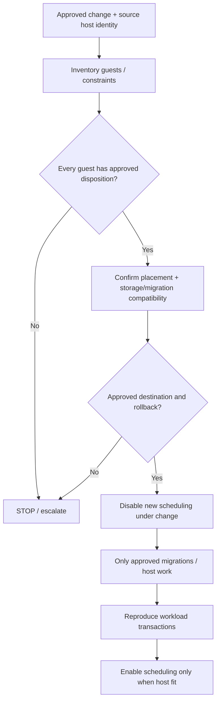

# SOP-MNT-001 — EDPM compute host maintenance

!!! warning "DRAFT — not authorized for live maintenance"
    No production validation or named approver exists. Changes require an approved maintenance window, workloads reviewed by their owners, and release-specific Red Hat procedure. This page is **not** an instruction to reboot.

| Control | Value | Control | Value |
| --- | --- | --- | --- |
| SOP ID | SOP-MNT-001 | Version | 0.3.0 |
| Status | **DRAFT** | Level | L1 inventory; **L2/L3 approved changes only** |
| RHOSO release | 18.x; exact micro-release **UNKNOWN** | Owner / approver | **Unassigned** |
| Last live validation | **Not performed** | Impact | Potential VM disruption |
| Authoritative source | EDPM NodeSet / deployment, Operator, GitOps as discovered | Change ticket | Required |

## 1. Purpose and acceptance

Execute approved compute maintenance without unplanned scheduling, VM migrations or loss of tenant availability. **Acceptance:** original workload transactions succeed after maintenance, host returns to required state, and every affected VM has an approved disposition.

## 2. Scope and execution context

[OCP] inventory Operator-owned `OpenStackDataPlaneNodeSet` and deployments; [OS] use authenticated OpenStackClient for Nova queries; [EDPM] any host operations require **separate release-supported procedure**. This SOP does not authorize reboot, rebuild, fencing or Ceph work.

## 3. Preconditions

- Named maintenance owner, ticket, approved workload list, window, communication and recovery plan.
- Check Instance HA interaction (if deployed), Nova cell membership, AZ/aggregates and Placement traits.
- Verify each guest's CPU compatibility, PCI/SR-IOV, NUMA/hugepages, storage and migration compatibility before considering live migration.
- Verify target host headroom for the *actual flavor and constraints*, not aggregate vCPU/RAM only.
- Determine CR/GitOps/Helm authoritative configuration ownership before any changes.

## 4. Impact and stop conditions

!!! danger "STOP"
    Never disable or migrate a host until workload owner approval, supported migration method, target eligibility and rollback are documented. A scheduler-disable action **does not** move existing VMs. Do not perform automatic evacuation or reboot.

## 5. Decision path



## 6. Procedure

**Step 1 — Discover management ownership [OCP, read-only].**

```bash
oc get openstackdataplanenodesets -A
oc get openstackdataplanedeployments -A
```

**Expected:** exact NodeSet/deployment and authoritative controller path, not guessed names.

**Step 2 — Verify compute and affected workload inventory [OS, read-only].** Supply approved `COMPUTE_HOST`.

```bash
openstack compute service list --host "$COMPUTE_HOST"
openstack server list --all-projects --host "$COMPUTE_HOST"
openstack hypervisor stats show
```

**Expected:** complete VM inventory and compute service state. The aggregate stats **do not** establish destination eligibility. Confirm Placement inventory/traits/NUMA/PCI and each VM's attached volumes.

**Step 3 — L2/L3 ONLY: disable *new* scheduling [OS, CHANGE].** Do not execute without a documented and approved change ID.

```bash
openstack compute service set --disable --disable-reason "$CHANGE_ID" "$COMPUTE_HOST" nova-compute
openstack compute service list --host "$COMPUTE_HOST"
```

**Expected:** service disabled for new scheduling. Existing guests remain on the host. This does **not** validate readiness to reboot.

**Step 4 — Migration execution requires a separate per-guest approved plan.** Do not use a generic bulk migration or automatic host reboot. Validate migration target, availability zone, same-cell requirements, NUMA/PCI, storage, Instance HA, downtime and rollback for **each VM**. Use [RHOSO maintenance documentation](https://docs.redhat.com/en/documentation/red_hat_openstack_services_on_openshift/18.0/html-single/maintaining_the_red_hat_openstack_services_on_openshift_deployment/index).

**Step 5 — L2/L3 ONLY: enable scheduling after source host and user transactions pass [OS, CHANGE].**

```bash
openstack compute service set --enable "$COMPUTE_HOST" nova-compute
openstack compute service list --host "$COMPUTE_HOST"
```

**Expected:** service `up/enabled`; further validation of guest placement and APIs still required.

## 7. Validation

Verify each migrated/retained guest's state, placement, network reachability, storage and expected application path. Reproduce the approved original VM/workload transaction. Record before/after evidence and unresolved constraints.

## 8. Rollback

If only scheduler-disable occurred and host is demonstrably healthy, approved rollback is to re-enable scheduling using Step 5. Guest relocation, reboot, disk or infrastructure rollback is **topology-dependent** and must be written in the change record **before** maintenance. On migration error, stop subsequent migrations and preserve state for investigation.

## 9. Evidence and escalation

**PROVEN HEALTHY:** exact host/guest checks. **PROVEN BROKEN:** failed migration or application transaction. **INFERENCE:** impacted capacity. **HYPOTHESIS:** storage/CPU mismatch until proven. **UNKNOWN:** unsupported relocation eligibility. L1 does not execute Step 3 or Step 5.

## 10. References

- [RHOSO maintaining deployment](https://docs.redhat.com/en/documentation/red_hat_openstack_services_on_openshift/18.0/html-single/maintaining_the_red_hat_openstack_services_on_openshift_deployment/index)
- [Worked example](EXAMPLE.md) — simulated
- [Release gate](../RELEASE-GATE.md) · [Escalation](../START-HERE.md)

## 11. Revision history

| Version | Date (UTC) | Description | Live validation |
| --- | --- | --- | --- |
| 0.1.0 | 2026-10-20 | Initial draft | None |
| 0.2.0 | 2026-10-21 | Visual format | None |
| 0.3.0 | 2026-10-22 | L1/L2/L3 separation, change gate, migration stop conditions | None |
