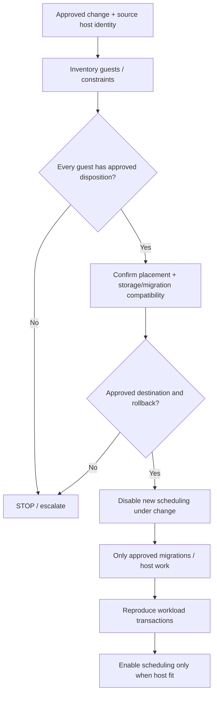

<div class="sop-page" markdown="1">

<div class="sop-banner" role="region" aria-label="Controlled SOP cover header">
  <div class="sop-brand"><span class="sop-mark">RHOSO</span><small>Red Hat OpenStack<br>Services on OpenShift</small></div>
  <div class="sop-banner-name"><strong>STANDARD OPERATING PROCEDURE (SOP)</strong><span>RHOSO EDPM Compute Host Maintenance</span></div>
</div>

# RHOSO EDPM Compute Host Maintenance

| Document reference | RHOSO-ITD-SOP-MNT-001 | Revision | REV. 00.4 |
| --- | --- | --- | --- |
| Effective date | Pending approval | Status | **DRAFT — UNAPPROVED** |
| Target platform | RHOSO 18.x; micro-release not yet validated | Classification | **Public engineering draft** |

!!! danger "Operational release restriction"
    **DRAFT / NO-GO for unrestricted production use.** No named approver or site-specific execution validation exists. L1 only performs approved read-only steps. This public GitHub repository must not contain confidential incident details, credentials or organization-specific restricted material. See [release gate](../RELEASE-GATE.md).

## DOCUMENT INFORMATION

| Field | Value | Field | Value |
| --- | --- | --- | --- |
| Department | Information Technology — Cloud Platform Services *(confirm actual unit)* | Controlled document ID | RHOSO-ITD-SOP-MNT-001 |
| Document developer | [Developer name / designation] | Signature / date | Pending / Pending |
| Release / applicability | RHOSO 18.x (site version verification required) | Document custodian | [Assigned role required] |

## DOCUMENT REVIEW AND APPROVAL

| Action | Name | Title / responsibility | Business unit | Signature | Date |
| --- | --- | --- | --- | --- | --- |
| Reviewed by | Pending | RHOSO Technical Lead (L2/L3) | Cloud Platform | Pending | Pending |
| Reviewed by | Pending | IT Operations Manager (L1) | IT Operations | Pending | Pending |
| Approved by | Pending | Authorized Platform / Change Approver | Information Technology | Pending | Pending |

<div class="sop-public-notice"><strong>Publication and confidentiality notice.</strong> This site is a public engineering reference. Do not add organization-confidential instructions, access data, tenant identifiers or internal endpoints. If the organization requires a confidential controlled copy, publish it through an authorized private document-management system using the organization's approved confidentiality notice.</div>

## REVISION HISTORY

| Revision | Revision date (UTC) | Revision justification | Sections revised |
| --- | --- | --- | --- |
| REV. 00.0 | 2026-10-20 | Initial engineering draft | N/A |
| REV. 00.3 | 2026-10-22 | Added operational safety, escalation and verification gates | Existing operational content |
| **REV. 00.4** | **2026-11-03** | Corporate controlled-document layout and formal nine-section structure | Front matter; 1–9 |

## TABLE OF CONTENTS

| Section | Content | Section | Content |
| --- | --- | --- | --- |
| 1 | [Purpose](#1-purpose) | 6 | [Implementation](#6-implementation) |
| 2 | [Scope](#2-scope) | 7 | [Review requirements](#7-review-requirements) |
| 3 | [Applicability](#3-applicability) | 8 | [References](#8-references) |
| 4 | [Terms & definitions](#4-terms-definitions) | 9 | [Appendices](#9-appendices) |
| 5 | [Roles & responsibilities](#5-roles-responsibilities) | | |

## 1 PURPOSE

Execute approved compute maintenance without unplanned scheduling, VM migrations or loss of tenant availability. **Acceptance:** original workload transactions succeed after maintenance, host returns to required state, and every affected VM has an approved disposition.

## 2 SCOPE

[OCP] inventory Operator-owned `OpenStackDataPlaneNodeSet` and deployments; [OS] use authenticated OpenStackClient for Nova queries; [EDPM] any host operations require **separate release-supported procedure**. This SOP does not authorize reboot, rebuild, fencing or Ceph work.

## 3 APPLICABILITY

Applies to supported compute host maintenance in production, staging, UAT and DR with an approved change ticket. L1 inventory only; scheduling changes and migrations are restricted to authorized L2/L3 engineers.

**Document usage:** Maintenance / approved change. The procedure's read-only versus change-controlled boundaries are normative; a merged documentation change does not authorize infrastructure modifications.

## 4 TERMS & DEFINITIONS

| No. | Term | Description |
| --- | --- | --- |
| 1 | EDPM | External Data Plane Management; manages RHOSO external data-plane nodes. |
| 2 | Nova Compute | OpenStack service responsible for compute-host registration and VM lifecycle operations. |
| 3 | Disable scheduling | Administrative action preventing new instance placement; it does not relocate existing workloads. |
| 4 | Live migration | Supported movement of a running VM subject to CPU, PCI, NUMA, cell, network and storage compatibility. |
| 5 | Rollback | Explicit, pre-approved procedure to return a specific change to a safe previous state. |

## 5 ROLES & RESPONSIBILITIES

| No. | Responsible party | Role and responsibilities |
| --- | --- | --- |
| 1 | Change Requester | Provide host scope, affected guests, business impact, maintenance window and approvals. |
| 2 | L1 Operations | Discover hosts, collect read-only compute and VM inventories and document findings. |
| 3 | L2 RHOSO Engineer | Execute approved scheduling and per-VM maintenance actions; monitor acceptance and stop conditions. |
| 4 | L3 / Architect / Workload Owner | Verify topology, migration suitability, storage consistency, rollback and final workload validation. |
| 5 | Change Management | Approve the ticket and ensure communication, evidence and closure requirements. |

## 6 IMPLEMENTATION

Maintain an identified EDPM compute host with explicit workload approvals, Nova scheduling constraints, rollback and original-transaction validation.

### 6.1 Prerequisites and authorization

- Named maintenance owner, ticket, approved workload list, window, communication and recovery plan.
- Check Instance HA interaction (if deployed), Nova cell membership, AZ/aggregates and Placement traits.
- Verify each guest's CPU compatibility, PCI/SR-IOV, NUMA/hugepages, storage and migration compatibility before considering live migration.
- Verify target host headroom for the *actual flavor and constraints*, not aggregate vCPU/RAM only.
- Determine CR/GitOps/Helm authoritative configuration ownership before any changes.

### 6.2 Impact, risk and stop conditions

!!! danger "STOP"
    Never disable or migrate a host until workload owner approval, supported migration method, target eligibility and rollback are documented. A scheduler-disable action **does not** move existing VMs. Do not perform automatic evacuation or reboot.

### 6.3 Decision flow



### 6.4 Execution procedure

**Step 1 — Discover management ownership [OCP, read-only].**

```bash
oc get openstackdataplanenodesets -A
oc get openstackdataplanedeployments -A
```

**Expected:** exact NodeSet/deployment and authoritative controller path, not guessed names.

**Step 2 — Verify compute and affected workload inventory [OS, read-only].** Supply approved `COMPUTE_HOST`.

```bash
openstack compute service list --host "$COMPUTE_HOST"
openstack server list --all-projects --host "$COMPUTE_HOST"
openstack hypervisor stats show
```

**Expected:** complete VM inventory and compute service state. The aggregate stats **do not** establish destination eligibility. Confirm Placement inventory/traits/NUMA/PCI and each VM's attached volumes.

**Step 3 — L2/L3 ONLY: disable *new* scheduling [OS, CHANGE].** Do not execute without a documented and approved change ID.

```bash
openstack compute service set --disable --disable-reason "$CHANGE_ID" "$COMPUTE_HOST" nova-compute
openstack compute service list --host "$COMPUTE_HOST"
```

**Expected:** service disabled for new scheduling. Existing guests remain on the host. This does **not** validate readiness to reboot.

**Step 4 — Migration execution requires a separate per-guest approved plan.** Do not use a generic bulk migration or automatic host reboot. Validate migration target, availability zone, same-cell requirements, NUMA/PCI, storage, Instance HA, downtime and rollback for **each VM**. Use [RHOSO maintenance documentation](https://docs.redhat.com/en/documentation/red_hat_openstack_services_on_openshift/18.0/html-single/maintaining_the_red_hat_openstack_services_on_openshift_deployment/index).

**Step 5 — L2/L3 ONLY: enable scheduling after source host and user transactions pass [OS, CHANGE].**

```bash
openstack compute service set --enable "$COMPUTE_HOST" nova-compute
openstack compute service list --host "$COMPUTE_HOST"
```

**Expected:** service `up/enabled`; further validation of guest placement and APIs still required.

### 6.5 Acceptance and validation

Verify each migrated/retained guest's state, placement, network reachability, storage and expected application path. Reproduce the approved original VM/workload transaction. Record before/after evidence and unresolved constraints.

### 6.6 Rollback or restoration

If only scheduler-disable occurred and host is demonstrably healthy, approved rollback is to re-enable scheduling using Step 5. Guest relocation, reboot, disk or infrastructure rollback is **topology-dependent** and must be written in the change record **before** maintenance. On migration error, stop subsequent migrations and preserve state for investigation.

### 6.7 Evidence handling and escalation

**PROVEN HEALTHY:** exact host/guest checks. **PROVEN BROKEN:** failed migration or application transaction. **INFERENCE:** impacted capacity. **HYPOTHESIS:** storage/CPU mismatch until proven. **UNKNOWN:** unsupported relocation eligibility. L1 does not execute Step 3 or Step 5.

## 7 REVIEW REQUIREMENTS

This SOP shall be reviewed **at least annually**, when the deployed RHOSO micro-release or related Operators change, and after significant incidents, topology changes, or revised security and operational policies. The document developer updates the revision record; the RHOSO technical lead and IT Operations reviewer verify commands, scope, evidence, role boundaries and applicability before the designated approver authorizes its effective date.

Prior revisions must remain recoverable through Git history or the approved document-control system. An automated MkDocs build and Git merge **do not** constitute authorization for production execution.

## 8 REFERENCES

- [RHOSO maintaining deployment](https://docs.redhat.com/en/documentation/red_hat_openstack_services_on_openshift/18.0/html-single/maintaining_the_red_hat_openstack_services_on_openshift_deployment/index)
- [Worked example](EXAMPLE.md) — simulated
- [Release gate](../RELEASE-GATE.md) · [Escalation](../START-HERE.md)

- [Red Hat RHOSO 18.0 documentation](https://docs.redhat.com/en/documentation/red_hat_openstack_services_on_openshift/18.0)
- [L1/L2/L3 escalation instructions](../START-HERE.md)
- [Release-specific compatibility register](../COMPATIBILITY.md)
- [Production release gate](../RELEASE-GATE.md)

## 9 APPENDICES

### Appendix A — Incident / change evidence register

| Evidence field | Record location |
| --- | --- |
| Ticket / change reference | [Approved ITSM ticket] |
| Cloud, region and UTC time | [Redacted secure evidence record] |
| Original transaction and observed failure | [Request ID / safe summary] |
| First proven failing boundary | [Short, timestamped redacted evidence] |
| Unknowns and escalation owner | [Named team or on-call queue] |
| Validation / rollback outcome | [Original transaction re-tested, or NOT VALIDATED] |

### Appendix B — Worked engineer example

See [the sample for this SOP](EXAMPLE.md). All illustrative outputs are **SIMULATED** and must never be presented as live RHOSO evidence.

<div class="sop-paper-footer"><span>RHOSO · Engineering DRAFT · Public reference</span><span>RHOSO-ITD-SOP-MNT-001 · REV. 00.4</span></div>

</div>
