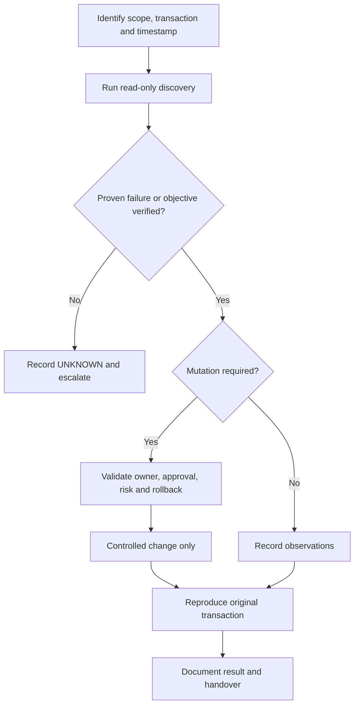

# SOP-MNT-001 · Scheduled EDPM Compute Host Maintenance

> [!WARNING]
> **DRAFT — NOT APPROVED FOR LIVE PRODUCTION.** Release-dependent commands require target-environment verification. **No production execution has been performed.**

| Document control | Value | Document control | Value |
| :--- | :--- | :--- | :--- |
| **SOP ID** | SOP-MNT-001 | **Version** | 0.2.0 |
| **Status** | DRAFT | **Type** | maintenance |
| **Release** | RHOSO 18.x (micro-release unverified) | **Owner / Approver** | Not assigned |
| **Last live validation** | Not performed | **Execution** | [OCP] / [OS] as marked |
| **Change reference** | Required for any write | **Authoritative owner** | Discover Operator / GitOps / Helm |

**Quick navigation:** [Purpose](#1-purpose) · [Scope](#2-scope) · [Prerequisites](#3-prerequisites) · [Risks](#4-impact-and-risks) · [Flow](#5-decision-path) · [Steps](#6-detailed-procedure) · [Validation](#7-validation) · [Rollback](#8-rollback--recovery) · [Troubleshooting](#9-troubleshooting-and-escalation) · [References](#10-references) · [History](#11-revision-history)

## 1. Purpose

Perform an approved host maintenance sequence with verified guest eligibility and safe scheduling controls.

**Expected operational outcome:** Original workload transactions pass, guests are accounted for, and host state is verified after approved maintenance.

## 2. Scope

RHOSO 18.x only with deployed, supported components. Reference names and namespaces are **not** assumed. See the site-specific support matrix before performing changes.

## 3. Prerequisites

Authenticated [OCP] OpenShift workstation and discovered [OS] OpenStackClient when needed; least-privilege credentials; correct cloud/project/region/host; incident or approved change ticket; known authoritative owner.

## 4. Impact and risks

> [!CAUTION]
> State-changing scheduling operations; incorrect migrations/reboots can interrupt VMs or create split-brain. No automatic reboot, evacuation or pod delete. **STOP** if the original transaction, command context, controller ownership, prerequisites or rollback capability is unknown.

## 5. Decision path

## 6. Detailed procedure

| Step | Description | Exact command and context | Expected result | Interpretation / stop |
| :--- | :--- | :--- | :--- | :--- |
| 1 | Inventory affected guests | `[OS] openstack server list --all-projects --host "$COMPUTE_HOST"` | Complete instance list | Stop if workload ownership/availability unknown |
| 2 | Check capacity and policies | `[OS] openstack hypervisor stats show` | Fleet-level capacity summary | Not sufficient to establish target placement; inspect traits/NUMA/AZ |
| 3 | Disable new scheduling | `[OS][CHANGE] openstack compute service set --disable --disable-reason "$CHANGE_ID" "$COMPUTE_HOST" nova-compute` | Disabled scheduler flag | Only after approved change and ownership check |
| 4 | Verify disable | `[OS] openstack compute service list --host "$COMPUTE_HOST"` | Disabled as intended | Existing VMs remain on host |
| 5 | Restore scheduling after validation | `[OS][CHANGE] openstack compute service set --enable "$COMPUTE_HOST" nova-compute` | Enabled and up after accepted maintenance | Only after workload and host checks |

> [!NOTE]
> Run commands **individually in their stated execution context**. Substitute real discovered values. The matrix above is a reference; do not execute a table directly.

### Full procedure and environment discovery

| Field | Value |
| --- | --- |
| Status / version | DRAFT / 0.1.0 |
| Scope | RHOSO 18.x EDPM compute nodes; Nova service and running instances |
| Execution | [OS] authenticated OpenStackClient; [OCP] operator/CR inventory; [EDPM] approved host |
| Owner / approver | To be assigned |
| Last site validation | Not performed |
| Official reference | https://docs.redhat.com/en/documentation/red_hat_openstack_services_on_openshift/18.0/html-single/maintaining_the_red_hat_openstack_services_on_openshift_deployment/index |

## Change gate and preconditions

Use only with an **approved** change ID, defined workload downtime tolerance, workload-owner authorization and a recovery window. Check supported release-specific host-maintenance steps, RHOSO Operator/EDPM NodeSet ownership and GitOps reconciliation before editing any desired state. Coordinate with Instance HA, if installed, to avoid false evacuation.

Confirm destination host eligibility, capacity, same Nova cell and policy/AZ/aggregate constraints, CPU model, NUMA/hugepages, PCI/SR-IOV, storage/shared-storage or block-migration support, and in-flight migrations. Do **not** assume all VMs support live migration. Do not use the word *reserved* in disable reasons when Instance HA is in use.

~~~bash
# [OCP][RO] Discover controller-owned data plane; no changes.
oc get openstackdataplanenodesets -A
oc get openstackdataplanedeployments -A

# [OS][RO] Supply real values only after reviewing the maintenance ticket.
# COMPUTE_HOST and CHANGE_ID must be set in this OpenStackClient shell.
openstack compute service list --host "$COMPUTE_HOST"
openstack server list --all-projects --host "$COMPUTE_HOST"
openstack hypervisor stats show
openstack hypervisor show "$COMPUTE_HOST"
openstack server migration list --server "$VM_UUID"
openstack server volume list "$VM_UUID"
~~~

**STOP** if host identification, source-of-truth, workload list, destination or rollback is uncertain. Host-level spare capacity is not sufficient by itself to prove Placement placement compatibility.

## Approved minimum change — operator run individually

~~~bash
# [OS][CHANGE] Disable new scheduling; existing guests are NOT moved.
openstack compute service set --disable --disable-reason "$CHANGE_ID" "$COMPUTE_HOST" nova-compute

# [OS][RO] Verify host scheduling state and unaffected VM inventory.
openstack compute service list --host "$COMPUTE_HOST"
openstack server list --all-projects --host "$COMPUTE_HOST"

# [OS][CHANGE] Optional; only for a VM confirmed live-migration compatible.
# Requires an approved target, VM_UUID and an authorized migration window.
openstack server migrate --live-migration --host "$TARGET_HOST" --wait "$VM_UUID"

# [OS][RO] Verify actual VM placement and migration outcome.
openstack server show "$VM_UUID" -f yaml
openstack server migration list --server "$VM_UUID"
openstack server list --all-projects --host "$COMPUTE_HOST"
~~~

**Do not reboot or remove the host as part of this generic SOP.** EDPM reboots, node replacement, fencing, Instance HA and co-located Ceph operations need separately reviewed RHOSO release-specific procedures. Continue only when all affected workloads have approved dispositions.

## Restore scheduling and validate

~~~bash
# [OS][CHANGE] Only after maintenance finished and source host tested.
openstack compute service set --enable "$COMPUTE_HOST" nova-compute

# [OS][RO] Confirm service UP/enabled, compute inventories and placement.
openstack compute service list --host "$COMPUTE_HOST"
openstack hypervisor show "$COMPUTE_HOST"
openstack server list --all-projects --host "$COMPUTE_HOST"
~~~

**Validation:** reproduce a permitted instance placement/migration transaction and verify guest reachability, console, attached storage and networking. An enabled/up service status is insufficient alone.

**Rollback:** if a migration fails, stop subsequent migrations; preserve the disabled scheduler state until reviewed. If host health is confirmed but only scheduling disable must be undone, re-enable using the command above under change control. Guest relocation rollback is VM-, storage- and topology-dependent and must be separately specified in the approved change.

Record observed before/after states, VM IDs as secure ticket references, migration errors, owner sign-off and outstanding limitations.

## 7. Validation

Original workload transactions pass, guests are accounted for, and host state is verified after approved maintenance. Record observed values, timestamp, request/VM/host reference, and explicit PASS / FAIL / UNAVAILABLE; a healthy Kubernetes object is not an end-to-end test.

## 8. Rollback / recovery

If only disable was performed and host is proven fit, re-enable under change control; failed migration rollback is guest/storage/topology-dependent.

## 9. Troubleshooting and escalation

Classify evidence into **PROVEN HEALTHY**, **PROVEN BROKEN**, **INFERENCE**, **HYPOTHESIS**, and **UNKNOWN**. Record the first proven boundary; do not infer trigger/root cause from labels without logs.

## 10. References

- [RHOSO 18.x admin command reference](../../docs/00-usage-and-conventions.md)
- [Official Red Hat sources](../../docs/official-sources.md)
- [Worked example for this area](EXAMPLE.md) (**SIMULATED**, not observed)

## 11. Revision history

| Version | Date (UTC) | Change | Site verification |
| :--- | :--- | :--- | :--- |
| 0.1.0 | 2026-10-20 | Starter draft | Not performed |
| 0.2.0 | 2026-10-21 | Visual SOP metadata, step/expected matrices and example links | Not performed |
