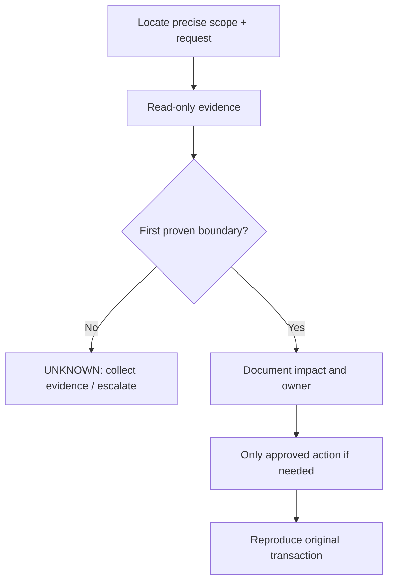

# Worked example · Daily shift verification

> [!WARNING]
> **SIMULATED TRAINING EXAMPLE.** All evidence below is invented to illustrate documentation technique. Do not copy identifiers, assume a diagnosis or execute change steps without site approval.

| Field | Value |
| :--- | :--- |
| **Applicable SOP** | [SOP-OPS-001](./daily-health-check.md) |
| **Scenario** | Daily shift verification |
| **Status** | EXAMPLE ONLY / not approved |
| **Evidence type** | SIMULATED, not from a live cluster |
| **Contexts** | [OCP] workstation; [OS] authenticated OpenStackClient where specified |
| **Version** | RHOSO 18.x concept; exact micro-release unverified |

## 1. Purpose

Show an engineer how to apply the related SOP, interpret expected results, decide when to stop, and document the actual success criteria.

## 2. Scope

Training only. No real cluster objects, pod names, credentials, IP addresses or tenant identifiers.

## 3. Preconditions

Discover deployment, authenticate by approved method, verify installed OpenStackClient, and record incident or change ticket before action.

## 4. Impact and risks

> [!CAUTION]
> Do not translate fictional observations into production root-cause assertions. Mutating steps require formal change approval, ownership and documented rollback.

## 5. Decision path

## 6. Detailed procedure — example walkthrough

| Step | What the engineer does | Simulated evidence / expected output | Interpretation / next action |
| :--- | :--- | :--- | :--- |
| 1 | Shift engineer uses approved OpenShift session and chooses the RHOSO namespace returned by `oc get openstackcontrolplanes -A`. | Document actual command output in secure incident ticket | Follow linked SOP; stop if ambiguous |
| 2 | Executes `bash -n scripts/rhoso-healthcheck.sh`; then `RHOSO_NAMESPACE="<discovered-namespace>" bash scripts/rhoso-healthcheck.sh` on the workstation. | Document actual command output in secure incident ticket | Follow linked SOP; stop if ambiguous |
| 3 | **SIMULATED report:** `PASS: OpenShift identity`; `WARN: deployment condition unknown`; `UNAVAILABLE: optional telemetry check` (not actual output format). | **SIMULATED** sample only | Do not extrapolate without live proof |
| 4 | Engineer does not call the environment healthy merely because the shell command completed. Records unavailable checks, redacts report and opens a targeted ticket. | Document actual command output in secure incident ticket | Follow linked SOP; stop if ambiguous |
| 5 | Success means every implemented check has a classified result; only a separate VM/API synthetic transaction proves end-to-end service function. | Document actual command output in secure incident ticket | Follow linked SOP; stop if ambiguous |

## 7. Validation

Success means every implemented check has a classified result; only a separate VM/API synthetic transaction proves end-to-end service function.

**Acceptance evidence:** record exact command/transaction, timestamp, expected vs actual user-visible result, fault-domain boundary and secure redacted ticket link.

## 8. Rollback / recovery

This example performs no live modifications. No automatic rollback is run. Approved changes must specify independent prerequisites and rollback before execution.

## 9. Troubleshooting and escalation

Classify observations as **PROVEN HEALTHY**, **PROVEN BROKEN**, **INFERENCE**, **HYPOTHESIS** and **UNKNOWN**. Simulated outputs cannot prove any real fault.

## 10. References

- [Primary SOP](./daily-health-check.md)
- [RHOSO command contexts and caveats](https://github.com/sheejithkv/RHOSO/blob/main/docs/00-usage-and-conventions.md)
- [Official Red Hat sources](https://github.com/sheejithkv/RHOSO/blob/main/docs/official-sources.md)

## 11. Revision history

| Version | Date (UTC) | Change | Real-cluster test |
| :--- | :--- | :--- | :--- |
| 0.1.0 | 2026-10-21 | First simulated training example | Not performed |
