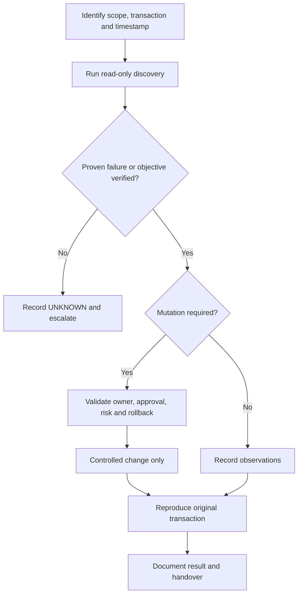

# SOP-OPS-001 · Daily RHOSO Operational Health Check

> [!WARNING]
> **DRAFT — NOT APPROVED FOR LIVE PRODUCTION.** Release-dependent commands require target-environment verification. **No production execution has been performed.**

| Document control | Value | Document control | Value |
| :--- | :--- | :--- | :--- |
| **SOP ID** | SOP-OPS-001 | **Version** | 0.2.0 |
| **Status** | DRAFT | **Type** | operations |
| **Release** | RHOSO 18.x (micro-release unverified) | **Owner / Approver** | Not assigned |
| **Last live validation** | Not performed | **Execution** | [OCP] / [OS] as marked |
| **Change reference** | Required for any write | **Authoritative owner** | Discover Operator / GitOps / Helm |

**Quick navigation:** [Purpose](#1-purpose) · [Scope](#2-scope) · [Prerequisites](#3-prerequisites) · [Risks](#4-impact-and-risks) · [Flow](#5-decision-path) · [Steps](#6-detailed-procedure) · [Validation](#7-validation) · [Rollback](#8-rollback--recovery) · [Troubleshooting](#9-troubleshooting-and-escalation) · [References](#10-references) · [History](#11-revision-history)

## 1. Purpose

Determine whether implemented OpenShift/RHOSO checks pass, fail or cannot be executed.

**Expected operational outcome:** Timestamped report plus explicitly classified failures/unavailable checks; a separate end-to-end transaction test is required to prove workload health.

## 2. Scope

RHOSO 18.x only with deployed, supported components. Reference names and namespaces are **not** assumed. See the site-specific support matrix before performing changes.

## 3. Prerequisites

Authenticated [OCP] OpenShift workstation and discovered [OS] OpenStackClient when needed; least-privilege credentials; correct cloud/project/region/host; incident or approved change ticket; known authoritative owner.

## 4. Impact and risks

> [!CAUTION]
> Read-only against infrastructure; local outputs can contain sensitive topology. Do not publish raw reports. **STOP** if the original transaction, command context, controller ownership, prerequisites or rollback capability is unknown.

## 5. Decision path

## 6. Detailed procedure

| Step | Description | Exact command and context | Expected result | Interpretation / stop |
| :--- | :--- | :--- | :--- | :--- |
| 1 | Discover cloud scope | `[OCP] oc get openstackcontrolplanes -A` | Correct namespace and CR identified | Stop for ambiguous deployment |
| 2 | Verify script syntax | `[OCP] bash -n scripts/rhoso-healthcheck.sh` | Exit code 0 | Syntax only, not live proof |
| 3 | Run read-only collector | `[OCP] RHOSO_NAMESPACE="<discovered-namespace>" bash scripts/rhoso-healthcheck.sh` | Timestamped PASS/WARN/FAIL/UNAVAILABLE report | Investigate per check; do not auto-repair |

> [!NOTE]
> Run commands **individually in their stated execution context**. Substitute real discovered values. The matrix above is a reference; do not execute a table directly.

### Full procedure and environment discovery

| Field | Value |
| --- | --- |
| Status / version | DRAFT / 0.1.0 |
| Scope | RHOSO 18.x control plane, OpenShift, EDPM, enabled OpenStack services |
| Execution | [OCP] admin workstation; [OS] OpenStackClient via script |
| Owner / approver | To be assigned |
| Last site validation | Not performed |

## Transaction and acceptance

Purpose: determine whether each **implemented** read-only check succeeds; identify failed or unavailable checks and dispatch targeted investigation. This is **not** a synthetic tenant transaction test and cannot prove end-to-end health by itself.

## Prerequisites and discovery

- Authenticated oc session, jq, permissions to list relevant CRs/pods and exec into the intended OpenStackClient; service-specific components may not be deployed.
- Select the appropriate RHOSO namespace and cloud when multiple exist. Do not guess names.
- Report output is local and can expose topology; store under restricted access, never commit it.

~~~bash
# [OCP][RO] Validate CLI identity and control-plane discovery.
oc whoami
oc get openstackcontrolplanes -A
oc get openstackdataplanenodesets -A
oc get openstackdataplanedeployments -A

# [OCP][RO] Discover an authenticated client pod and its namespace.
oc get pods -A -o wide | grep -i openstackclient

# [OCP][RO] Validate health-check script syntax; no cluster changes.
bash -n scripts/rhoso-healthcheck.sh

# [OCP][RO] Execute; replace with the namespace discovered above.
RHOSO_NAMESPACE="<discovered-namespace>" bash scripts/rhoso-healthcheck.sh
~~~

## Interpret and triage

- **PASS**: implemented check passed at collection time; confirm real user/API transaction separately when incident-driven.
- **WARN**: degraded condition or warning; correlate timestamps and owner.
- **FAIL**: independently confirmed check failure; capture first proven failing boundary and incident request ID.
- **UNAVAILABLE**: check could not be completed (RBAC, absent optional component, unavailable CLI/context). Do **not** conflate with either healthy or failed.
- Exit 0 = checks pass, 1 = warnings/unavailable, 2 = failures/prerequisite failure, per current script implementation.

Capture the script's generated report path, timestamp, precise scope, failed commands, output redaction status, and ticket reference. Correlate with **original user-visible transaction**, not only a pod list.

## Handover and change safety

No automatic restarts, pod deletion, failover, CR edits, or recovery. Route abnormal results to the service owner. Follow the relevant incident SOP for the first proven failure. Record gaps as issues and link [IMPROVEMENTS.md](../IMPROVEMENTS.md).

**Completion:** archived redacted summary, assigned follow-ups, and confirmation whether an end-to-end test has or has not been performed.

## 7. Validation

Timestamped report plus explicitly classified failures/unavailable checks; a separate end-to-end transaction test is required to prove workload health. Record observed values, timestamp, request/VM/host reference, and explicit PASS / FAIL / UNAVAILABLE; a healthy Kubernetes object is not an end-to-end test.

## 8. Rollback / recovery

No infrastructure mutation; no rollback required. Remove only local reports under approved retention procedure.

## 9. Troubleshooting and escalation

Classify evidence into **PROVEN HEALTHY**, **PROVEN BROKEN**, **INFERENCE**, **HYPOTHESIS**, and **UNKNOWN**. Record the first proven boundary; do not infer trigger/root cause from labels without logs.

## 10. References

- [RHOSO 18.x admin command reference](https://github.com/sheejithkv/RHOSO/blob/main/docs/00-usage-and-conventions.md)
- [Official Red Hat sources](https://github.com/sheejithkv/RHOSO/blob/main/docs/official-sources.md)
- [Worked example for this area](EXAMPLE.md) (**SIMULATED**, not observed)

## 11. Revision history

| Version | Date (UTC) | Change | Site verification |
| :--- | :--- | :--- | :--- |
| 0.1.0 | 2026-10-20 | Starter draft | Not performed |
| 0.2.0 | 2026-10-21 | Visual SOP metadata, step/expected matrices and example links | Not performed |
