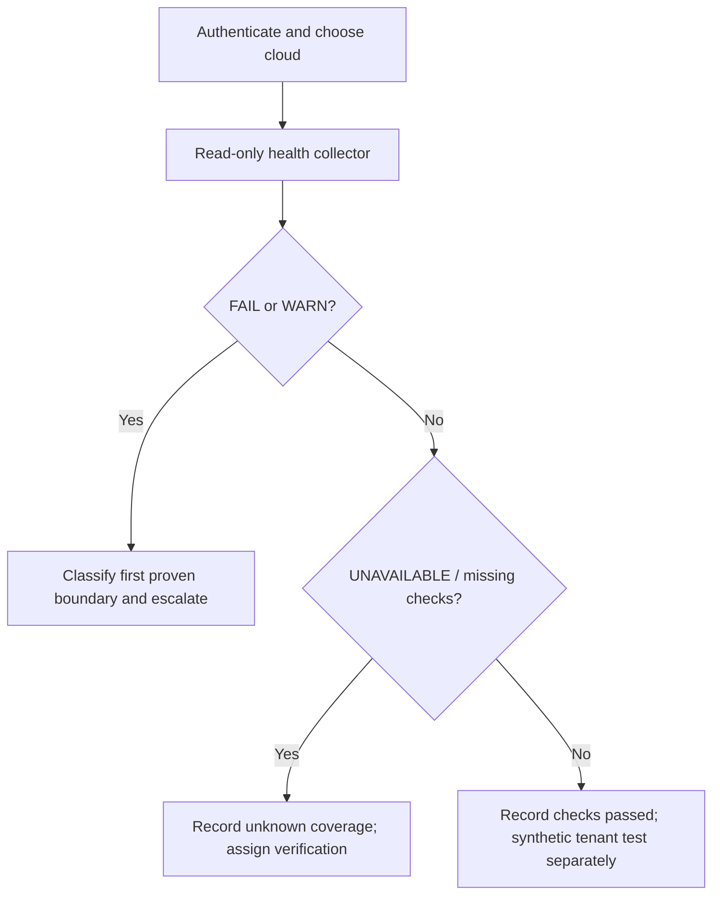

# SOP-OPS-001 — Daily RHOSO operational review

!!! warning "DRAFT — engineering review only"
    **Not approved for production execution.** No site validation or named approver has been recorded. Confirm installed RHOSO micro-release, CR ownership, privileges, optional services and actual workload constraints. Follow [release gates](../RELEASE-GATE.md).

| Control | Value | Control | Value |
| --- | --- | --- | --- |
| SOP | SOP-OPS-001 | Version | 0.3.0 |
| Status | **DRAFT** | Intended audience | L1 investigation; L2/L3 escalation |
| RHOSO applicability | **18.x — exact micro-release UNKNOWN** | Owner / approver | **Unassigned / unassigned** |
| Last live validation | **NOT PERFORMED** | Risk | Read-only to cluster; local output can be sensitive |
| Primary fault domain | OpenShift / RHOSO / EDPM / OpenStack API | Change record | Not required |

## 1. Purpose and acceptance

Determine the observed state of a selected RHOSO cloud without modifying infrastructure. The check is a **screening collector**, not an end-to-end tenant transaction.

**Acceptance:** Timestamped PASS/WARN/FAIL/UNAVAILABLE/SKIP results with faults assigned for follow-up. Any incident is validated by reproducing its original transaction.

## 2. Scope and execution contexts

Cluster and RHOSO CR/API inventory only for services implemented in the chosen namespace. Optional services may legitimately be absent; do not force deployment assumptions.

- **[OCP]** authenticated OpenShift administration workstation.
- **[OS]** authenticated, discovered OpenStackClient pod.
- **[EDPM]** approved RHEL data-plane host.
- **[POD]** discovered container in its actual namespace.

## 3. Prerequisites and authorization

- Authenticate using the approved OpenShift identity provider; verify `oc whoami`.
- Have `oc`, `jq`, Bash and rights to inspect RHOSO CRs; only approved pod exec for OpenStack API checks.
- Discover the intended RHOSO namespace. If more than one control plane exists, choose one deliberately.
- Use a private workstation with restricted local output storage.

## 4. Impact, risk and stop conditions

!!! danger "STOP"
    Do not restart pods, edit CRs, or delete local evidence. Treat UNAVAILABLE as **not checked**, never healthy; SKIP means no applicable installed service was detected. The collector does not certify Galera synchronization or tenant end-to-end functionality.

## 5. Decision path



## 6. Procedure

**Step 1 — Discover scope [OCP, read-only].**

```bash
oc whoami
oc get openstackcontrolplanes -A
oc get openstackdataplanenodesets -A
oc get openstackdataplanedeployments -A
```

**Expected:** One or more real RHOSO instances are identified. **STOP** if the target namespace is ambiguous or inaccessible.

**Step 2 — Verify and execute the read-only collector [OCP].** Run from the checked-out repository root.

```bash
bash -n scripts/rhoso-healthcheck.sh
RHOSO_NAMESPACE="<discovered-rhoso-namespace>" bash scripts/rhoso-healthcheck.sh
```

**Expected:** a timestamped, locally restricted report folder and summary. Syntax check exit 0 **only proves Bash syntax**.

**Step 3 — Interpret each result.**

| Status | Meaning | L1 action |
| --- | --- | --- |
| PASS | The explicitly implemented invariant passed at this time | Record scope and timestamp; not E2E proof |
| WARN | Degraded, incomplete, or potential issue | Open ticket with evidence and owning team |
| FAIL | A failure of a defined invariant was observed | Escalate with first proven boundary |
| UNAVAILABLE | The check could not establish a state | Escalate verification gap; do not assume healthy |
| SKIP | The optional check was not applicable | Record absence and deployment baseline |

**Step 4 — Reproduce the actual reported failing transaction** using a separately approved read-only API call or safe synthetic test; a green Kubernetes object is not sufficient.

## 7. Validation and completion

Capture the report path, UTC timestamp, selected cloud namespace and any unverified checks. Confirm that any reported application problem is reproduced from the authorized client. **The script is not proof of full cloud availability.**

## 8. Rollback / restoration

No infrastructure modification; no rollback. Follow approved local evidence retention for report files.

## 9. Evidence and escalation

**PROVEN HEALTHY:** checks with exact predicates satisfied. **PROVEN BROKEN:** failed predicate and timestamp. **INFERENCE:** possible effects on users. **HYPOTHESIS:** candidate cause, unproven. **UNKNOWN:** missing API, credentials, log or test. Provide a redacted summary rather than uploading raw output.

Use [L1–L3 ownership and escalation](../START-HERE.md). Record incident-time and current-time evidence separately. A user-facing failure is not automatically proof of the ticket's assumed fault domain.

## 10. References

- [RHOSO official documentation](https://docs.redhat.com/en/documentation/red_hat_openstack_services_on_openshift/18.0)
- [RHOSO repository command reference](https://github.com/sheejithkv/RHOSO/tree/main/docs)
- [Worked operations example](EXAMPLE.md) — **SIMULATED**, not live evidence
- [Compatibility register](../COMPATIBILITY.md)

## 11. Revision history

| Version | Date (UTC) | Change | Site verification |
| --- | --- | --- | --- |
| 0.1.0 | 2026-10-20 | Initial draft | Not performed |
| 0.2.0 | 2026-10-21 | Structure and examples | Not performed |
| 0.3.0 | 2026-10-22 | Consolidated single procedure, role gates and verification criteria | Not performed |
