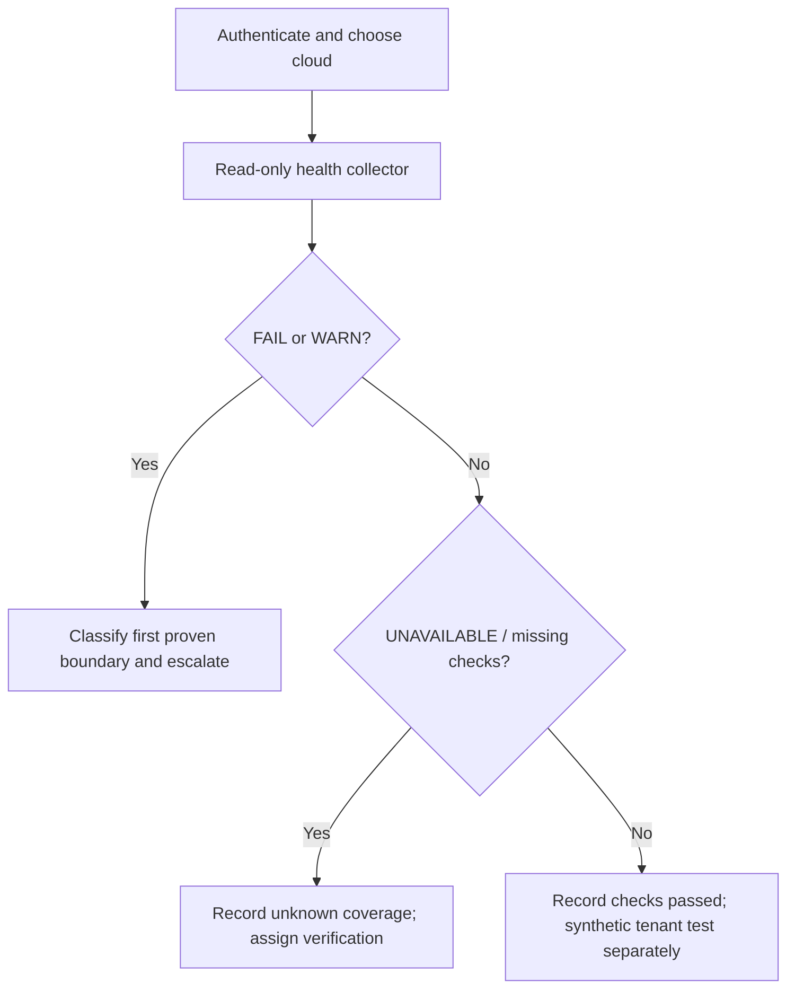

<div class="sop-page" markdown="1">

<div class="sop-banner" role="region" aria-label="Controlled SOP cover header">
  <div class="sop-brand"><span class="sop-mark">RHOSO</span><small>Red Hat OpenStack<br>Services on OpenShift</small></div>
  <div class="sop-banner-name"><strong>STANDARD OPERATING PROCEDURE (SOP)</strong><span>Daily RHOSO Operational Health Check</span></div>
</div>

# Daily RHOSO Operational Health Check

| Document reference | RHOSO-ITD-SOP-OPS-001 | Revision | REV. 00.4 |
| --- | --- | --- | --- |
| Effective date | Pending approval | Status | **DRAFT — UNAPPROVED** |
| Target platform | RHOSO 18.x; micro-release not yet validated | Classification | **Public engineering draft** |

!!! danger "Operational release restriction"
    **DRAFT / NO-GO for unrestricted production use.** No named approver or site-specific execution validation exists. L1 only performs approved read-only steps. This public GitHub repository must not contain confidential incident details, credentials or organization-specific restricted material. See [release gate](../RELEASE-GATE.md).

## DOCUMENT INFORMATION

| Field | Value | Field | Value |
| --- | --- | --- | --- |
| Department | Information Technology — Cloud Platform Services *(confirm actual unit)* | Controlled document ID | RHOSO-ITD-SOP-OPS-001 |
| Document developer | [Developer name / designation] | Signature / date | Pending / Pending |
| Release / applicability | RHOSO 18.x (site version verification required) | Document custodian | [Assigned role required] |

## DOCUMENT REVIEW AND APPROVAL

| Action | Name | Title / responsibility | Business unit | Signature | Date |
| --- | --- | --- | --- | --- | --- |
| Reviewed by | Pending | RHOSO Technical Lead (L2/L3) | Cloud Platform | Pending | Pending |
| Reviewed by | Pending | IT Operations Manager (L1) | IT Operations | Pending | Pending |
| Approved by | Pending | Authorized Platform / Change Approver | Information Technology | Pending | Pending |

<div class="sop-public-notice"><strong>Publication and confidentiality notice.</strong> This site is a public engineering reference. Do not add organization-confidential instructions, access data, tenant identifiers or internal endpoints. If the organization requires a confidential controlled copy, publish it through an authorized private document-management system using the organization's approved confidentiality notice.</div>

## REVISION HISTORY

| Revision | Revision date (UTC) | Revision justification | Sections revised |
| --- | --- | --- | --- |
| REV. 00.0 | 2026-10-20 | Initial engineering draft | N/A |
| REV. 00.3 | 2026-10-22 | Added operational safety, escalation and verification gates | Existing operational content |
| **REV. 00.4** | **2026-11-03** | Corporate controlled-document layout and formal nine-section structure | Front matter; 1–9 |

## TABLE OF CONTENTS

| Section | Content | Section | Content |
| --- | --- | --- | --- |
| 1 | [Purpose](#1-purpose) | 6 | [Implementation](#6-implementation) |
| 2 | [Scope](#2-scope) | 7 | [Review requirements](#7-review-requirements) |
| 3 | [Applicability](#3-applicability) | 8 | [References](#8-references) |
| 4 | [Terms & definitions](#4-terms-definitions) | 9 | [Appendices](#9-appendices) |
| 5 | [Roles & responsibilities](#5-roles-responsibilities) | | |

## 1 PURPOSE

Determine the observed state of a selected RHOSO cloud without modifying infrastructure. The check is a **screening collector**, not an end-to-end tenant transaction.

**Acceptance:** Timestamped PASS/WARN/FAIL/UNAVAILABLE/SKIP results with faults assigned for follow-up. Any incident is validated by reproducing its original transaction.

## 2 SCOPE

Cluster and RHOSO CR/API inventory only for services implemented in the chosen namespace. Optional services may legitimately be absent; do not force deployment assumptions.

- **[OCP]** authenticated OpenShift administration workstation.
- **[OS]** authenticated, discovered OpenStackClient pod.
- **[EDPM]** approved RHEL data-plane host.
- **[POD]** discovered container in its actual namespace.

## 3 APPLICABILITY

Applies to operations reviews in production, staging, UAT and DR **only where the deployed RHOSO micro-release and API permissions have been verified**. L1 may collect read-only evidence; L2/L3 own fault-domain diagnosis and separately approved changes.

**Document usage:** Operations / read-only. The procedure's read-only versus change-controlled boundaries are normative; a merged documentation change does not authorize infrastructure modifications.

## 4 TERMS & DEFINITIONS

| No. | Term | Description |
| --- | --- | --- |
| 1 | RHOSO | Red Hat OpenStack Services on OpenShift. |
| 2 | OCP | OpenShift Container Platform; execution context for oc commands. |
| 3 | EDPM | External Data Plane Management for RHOSO compute/data-plane nodes. |
| 4 | PASS / WARN / FAIL | Outcome of a specific, defined read-only invariant, not full end-to-end application health. |
| 5 | UNAVAILABLE / SKIP | An unverified check versus a nonapplicable optional check; neither is a success claim. |

## 5 ROLES & RESPONSIBILITIES

| No. | Responsible party | Role and responsibilities |
| --- | --- | --- |
| 1 | L1 Operations | Identify target cluster, execute permitted read-only collector, record status/timestamps, open incident on failures or unknown coverage. |
| 2 | L2 RHOSO Platform | Investigate exact failing service/transaction, validate observed invariants, propose minimum evidence-based remediation. |
| 3 | L3 / Service Owner | Confirm topology/version applicability; approve changes, recovery plans and cross-domain escalation. |
| 4 | IT Operations Manager | Review handover completeness, exception handling and document control. |

## 6 IMPLEMENTATION

Read-only assessment of the deployed OpenShift and RHOSO environment; this procedure does not independently certify tenant applications.

### 6.1 Prerequisites and authorization

- Authenticate using the approved OpenShift identity provider; verify `oc whoami`.
- Have `oc`, `jq`, Bash and rights to inspect RHOSO CRs; only approved pod exec for OpenStack API checks.
- Discover the intended RHOSO namespace. If more than one control plane exists, choose one deliberately.
- Use a private workstation with restricted local output storage.

### 6.2 Impact, risk and stop conditions

!!! danger "STOP"
    Do not restart pods, edit CRs, or delete local evidence. Treat UNAVAILABLE as **not checked**, never healthy; SKIP means no applicable installed service was detected. The collector does not certify Galera synchronization or tenant end-to-end functionality.

### 6.3 Decision flow



### 6.4 Execution procedure

**Step 1 — Discover scope [OCP, read-only].**

```bash
oc whoami
oc get openstackcontrolplanes -A
oc get openstackdataplanenodesets -A
oc get openstackdataplanedeployments -A
```

**Expected:** One or more real RHOSO instances are identified. **STOP** if the target namespace is ambiguous or inaccessible.

**Step 2 — Verify and execute the read-only collector [OCP].** Run from the checked-out repository root.

```bash
bash -n scripts/rhoso-healthcheck.sh
RHOSO_NAMESPACE="<discovered-rhoso-namespace>" bash scripts/rhoso-healthcheck.sh
```

**Expected:** a timestamped, locally restricted report folder and summary. Syntax check exit 0 **only proves Bash syntax**.

**Step 3 — Interpret each result.**

| Status | Meaning | L1 action |
| --- | --- | --- |
| PASS | The explicitly implemented invariant passed at this time | Record scope and timestamp; not E2E proof |
| WARN | Degraded, incomplete, or potential issue | Open ticket with evidence and owning team |
| FAIL | A failure of a defined invariant was observed | Escalate with first proven boundary |
| UNAVAILABLE | The check could not establish a state | Escalate verification gap; do not assume healthy |
| SKIP | The optional check was not applicable | Record absence and deployment baseline |

**Step 4 — Reproduce the actual reported failing transaction** using a separately approved read-only API call or safe synthetic test; a green Kubernetes object is not sufficient.

### 6.5 Acceptance and validation

Capture the report path, UTC timestamp, selected cloud namespace and any unverified checks. Confirm that any reported application problem is reproduced from the authorized client. **The script is not proof of full cloud availability.**

### 6.6 Rollback or restoration

No infrastructure modification; no rollback. Follow approved local evidence retention for report files.

### 6.7 Evidence handling and escalation

**PROVEN HEALTHY:** checks with exact predicates satisfied. **PROVEN BROKEN:** failed predicate and timestamp. **INFERENCE:** possible effects on users. **HYPOTHESIS:** candidate cause, unproven. **UNKNOWN:** missing API, credentials, log or test. Provide a redacted summary rather than uploading raw output.

Use [L1–L3 ownership and escalation](../START-HERE.md). Record incident-time and current-time evidence separately. A user-facing failure is not automatically proof of the ticket's assumed fault domain.

## 7 REVIEW REQUIREMENTS

This SOP shall be reviewed **at least annually**, when the deployed RHOSO micro-release or related Operators change, and after significant incidents, topology changes, or revised security and operational policies. The document developer updates the revision record; the RHOSO technical lead and IT Operations reviewer verify commands, scope, evidence, role boundaries and applicability before the designated approver authorizes its effective date.

Prior revisions must remain recoverable through Git history or the approved document-control system. An automated MkDocs build and Git merge **do not** constitute authorization for production execution.

## 8 REFERENCES

- [RHOSO official documentation](https://docs.redhat.com/en/documentation/red_hat_openstack_services_on_openshift/18.0)
- [RHOSO repository command reference](https://github.com/sheejithkv/RHOSO/tree/main/docs)
- [Worked operations example](EXAMPLE.md) — **SIMULATED**, not live evidence
- [Compatibility register](../COMPATIBILITY.md)

- [Red Hat RHOSO 18.0 documentation](https://docs.redhat.com/en/documentation/red_hat_openstack_services_on_openshift/18.0)
- [L1/L2/L3 escalation instructions](../START-HERE.md)
- [Release-specific compatibility register](../COMPATIBILITY.md)
- [Production release gate](../RELEASE-GATE.md)

## 9 APPENDICES

### Appendix A — Incident / change evidence register

| Evidence field | Record location |
| --- | --- |
| Ticket / change reference | [Approved ITSM ticket] |
| Cloud, region and UTC time | [Redacted secure evidence record] |
| Original transaction and observed failure | [Request ID / safe summary] |
| First proven failing boundary | [Short, timestamped redacted evidence] |
| Unknowns and escalation owner | [Named team or on-call queue] |
| Validation / rollback outcome | [Original transaction re-tested, or NOT VALIDATED] |

### Appendix B — Worked engineer example

See [the sample for this SOP](EXAMPLE.md). All illustrative outputs are **SIMULATED** and must never be presented as live RHOSO evidence.

<div class="sop-paper-footer"><span>RHOSO · Engineering DRAFT · Public reference</span><span>RHOSO-ITD-SOP-OPS-001 · REV. 00.4</span></div>

</div>
