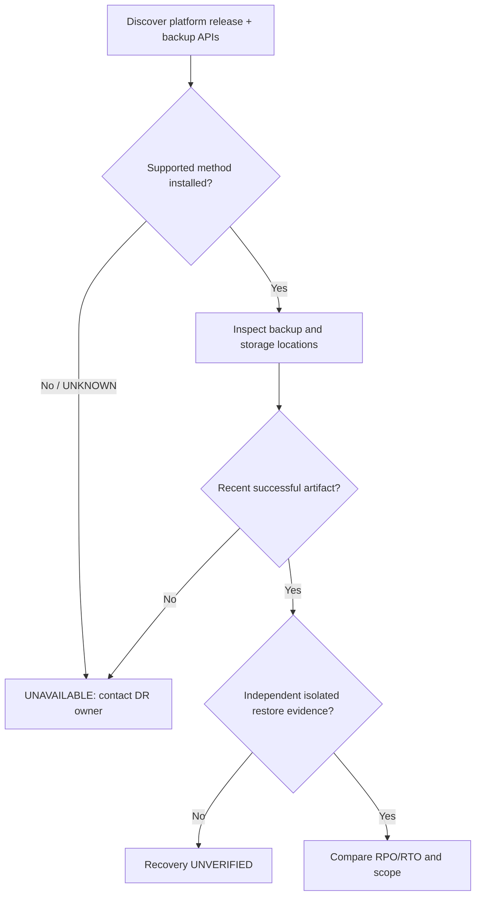

<div class="sop-page" markdown="1">

<div class="sop-banner" role="region" aria-label="Controlled SOP cover header">
  <div class="sop-brand"><span class="sop-mark">RHOSO</span><small>Red Hat OpenStack<br>Services on OpenShift</small></div>
  <div class="sop-banner-name"><strong>STANDARD OPERATING PROCEDURE (SOP)</strong><span>RHOSO Control-Plane Backup Readiness</span></div>
</div>

# RHOSO Control-Plane Backup Readiness

| Document reference | RHOSO-ITD-SOP-REC-001 | Revision | REV. 00.4 |
| --- | --- | --- | --- |
| Effective date | Pending approval | Status | **DRAFT — UNAPPROVED** |
| Target platform | RHOSO 18.x; micro-release not yet validated | Classification | **Public engineering draft** |

!!! danger "Operational release restriction"
    **DRAFT / NO-GO for unrestricted production use.** No named approver or site-specific execution validation exists. L1 only performs approved read-only steps. This public GitHub repository must not contain confidential incident details, credentials or organization-specific restricted material. See [release gate](../RELEASE-GATE.md).

## DOCUMENT INFORMATION

| Field | Value | Field | Value |
| --- | --- | --- | --- |
| Department | Information Technology — Cloud Platform Services *(confirm actual unit)* | Controlled document ID | RHOSO-ITD-SOP-REC-001 |
| Document developer | [Developer name / designation] | Signature / date | Pending / Pending |
| Release / applicability | RHOSO 18.x (site version verification required) | Document custodian | [Assigned role required] |

## DOCUMENT REVIEW AND APPROVAL

| Action | Name | Title / responsibility | Business unit | Signature | Date |
| --- | --- | --- | --- | --- | --- |
| Reviewed by | Pending | RHOSO Technical Lead (L2/L3) | Cloud Platform | Pending | Pending |
| Reviewed by | Pending | IT Operations Manager (L1) | IT Operations | Pending | Pending |
| Approved by | Pending | Authorized Platform / Change Approver | Information Technology | Pending | Pending |

<div class="sop-public-notice"><strong>Publication and confidentiality notice.</strong> This site is a public engineering reference. Do not add organization-confidential instructions, access data, tenant identifiers or internal endpoints. If the organization requires a confidential controlled copy, publish it through an authorized private document-management system using the organization's approved confidentiality notice.</div>

## REVISION HISTORY

| Revision | Revision date (UTC) | Revision justification | Sections revised |
| --- | --- | --- | --- |
| REV. 00.0 | 2026-10-20 | Initial engineering draft | N/A |
| REV. 00.3 | 2026-10-22 | Added operational safety, escalation and verification gates | Existing operational content |
| **REV. 00.4** | **2026-11-03** | Corporate controlled-document layout and formal nine-section structure | Front matter; 1–9 |

## TABLE OF CONTENTS

| Section | Content | Section | Content |
| --- | --- | --- | --- |
| 1 | [Purpose](#1-purpose) | 6 | [Implementation](#6-implementation) |
| 2 | [Scope](#2-scope) | 7 | [Review requirements](#7-review-requirements) |
| 3 | [Applicability](#3-applicability) | 8 | [References](#8-references) |
| 4 | [Terms & definitions](#4-terms-definitions) | 9 | [Appendices](#9-appendices) |
| 5 | [Roles & responsibilities](#5-roles-responsibilities) | | |

## 1 PURPOSE

Evaluate whether configured backups are recent and whether there is **independent, documented restore evidence** meeting the organization's RPO and RTO. A completed Velero Backup or a Bound PVC alone does not establish recovery viability.

## 2 SCOPE

[OCP] authenticated admin workstation. OADP/Velero and VolumeSnapshot APIs are **optional**; inspect only if installed. External Ceph/ODF, MariaDB/Galera data and EDPM host configurations may require separately managed protection.

## 3 APPLICABILITY

Applies to RHOSO environments whose maintenance release and chosen OADP/Velero/storage protection methods are supported. L1 inventories read-only APIs; L2 verifies backup artifacts; the DR owner signs off restore evidence. This SOP never initiates a restore.

**Document usage:** Recovery / read-only audit. The procedure's read-only versus change-controlled boundaries are normative; a merged documentation change does not authorize infrastructure modifications.

## 4 TERMS & DEFINITIONS

| No. | Term | Description |
| --- | --- | --- |
| 1 | RPO | Recovery Point Objective; acceptable maximum data-loss window. |
| 2 | RTO | Recovery Time Objective; maximum acceptable restoration duration. |
| 3 | OADP | OpenShift API for Data Protection, when supported and installed. |
| 4 | Velero | Kubernetes resource backup/restore tool used by applicable supported protection implementations. |
| 5 | Isolated restore test | Controlled test demonstrating recovery of backed-up dependencies without impacting production. |

## 5 ROLES & RESPONSIBILITIES

| No. | Responsible party | Role and responsibilities |
| --- | --- | --- |
| 1 | L1 Operations | Identify release and optional backup APIs; collect authorized read-only inventory. |
| 2 | L2 Backup / Storage Team | Verify reported backup status, artifact integrity, retention, encryption and data consistency. |
| 3 | L3 / DR Owner | Approve isolated restore methodology and confirm RPO/RTO and recovered services. |
| 4 | Platform Owner | Identify relevant RHOSO/OCP/EDPM/Ceph support matrix and dependencies. |

## 6 IMPLEMENTATION

Review compatibility, backup artifacts, retention and supported isolated restore evidence to determine whether the deployed RHOSO control plane meets documented recovery objectives.

### 6.1 Prerequisites and authorization

- Identify RHOSO and OpenShift exact versions, OADP/operator version and supported backup topology. The original RHOSO 18.0 OADP procedure has maintenance-release prerequisites; verify current documentation before relying on it.
- Approved access to backup CRs without disclosing credentials.
- Defined recovery objectives, off-cluster storage owner, last authorized isolated restore test and change authority for any eventual DR exercise.

### 6.2 Impact, risk and stop conditions

!!! danger "STOP"
    No restore, backup deletion, namespace replacement or storage manipulation from this page. If compatibility, artifact integrity, backup scope, or isolated restore evidence is unknown, report **UNVERIFIED** and escalate to the DR owner.

### 6.3 Decision flow



### 6.4 Execution procedure

**Step 1 — Inspect platform and backup API discovery [OCP, read-only].**

```bash
oc whoami
oc get clusterversion
oc get openstackcontrolplanes -A
oc api-resources | grep -Ei 'velero|dataprotectionapplication|volumesnapshot'
```

**Expected:** actual compatible APIs or documented absence. `grep` can exit 1 if no optional resources: classify **UNAVAILABLE**, not an infrastructure failure.

**Step 2 — If applicable CRDs exist, inspect backup resources [OCP, read-only].**

```bash
oc get dataprotectionapplications.oadp.openshift.io -A
oc get backupstoragelocations.velero.io -A
oc get backups.velero.io -A
oc get schedules.velero.io -A
oc get volumesnapshots.snapshot.storage.k8s.io -A
```

**Expected:** inventory and reported phase. Execute only commands whose API exists; failures from missing optional CRDs do not imply backup failure.

**Step 3 — Review recovery acceptance evidence.** Obtain the actual latest artifact, retention, off-cluster access, encryption controls, database/PVC consistency guarantees and last supported **isolated restore test** from the authorized storage/DR owner. Do not retrieve backup data or secrets into the runbook.

### 6.5 Acceptance and validation

Record backup age versus RPO, test restore time versus RTO, resources restored (including DB/PVC where applicable), date, storage backend and secure ticket reference. If no isolated restore passed, the result is **UNVERIFIED**; do not mark PASS.

### 6.6 Rollback or restoration

Read-only; none. Actual DR restoration requires an independently approved, supported, exercised procedure including fencing and data consistency safeguards.

### 6.7 Evidence handling and escalation

**PROVEN HEALTHY:** backup/storage/restore checks supported by redacted test evidence. **PROVEN BROKEN:** a backed-up dependency or supported restore test failed. **INFERENCE:** recovery impact. **HYPOTHESIS:** specific storage/DB cause without logs. **UNKNOWN:** absent test or inaccessible storage evidence. Escalate to DR/DBA/storage owners.

## 7 REVIEW REQUIREMENTS

This SOP shall be reviewed **at least annually**, when the deployed RHOSO micro-release or related Operators change, and after significant incidents, topology changes, or revised security and operational policies. The document developer updates the revision record; the RHOSO technical lead and IT Operations reviewer verify commands, scope, evidence, role boundaries and applicability before the designated approver authorizes its effective date.

Prior revisions must remain recoverable through Git history or the approved document-control system. An automated MkDocs build and Git merge **do not** constitute authorization for production execution.

## 8 REFERENCES

- [RHOSO backup/restore](https://docs.redhat.com/en/documentation/red_hat_openstack_services_on_openshift/18.0/html/backing_up_and_restoring_a_rhoso_control_plane)
- [Worked example](EXAMPLE.md) — simulated
- [Release gate](../RELEASE-GATE.md) · [Escalation](../START-HERE.md)

- [Red Hat RHOSO 18.0 documentation](https://docs.redhat.com/en/documentation/red_hat_openstack_services_on_openshift/18.0)
- [L1/L2/L3 escalation instructions](../START-HERE.md)
- [Release-specific compatibility register](../COMPATIBILITY.md)
- [Production release gate](../RELEASE-GATE.md)

## 9 APPENDICES

### Appendix A — Incident / change evidence register

| Evidence field | Record location |
| --- | --- |
| Ticket / change reference | [Approved ITSM ticket] |
| Cloud, region and UTC time | [Redacted secure evidence record] |
| Original transaction and observed failure | [Request ID / safe summary] |
| First proven failing boundary | [Short, timestamped redacted evidence] |
| Unknowns and escalation owner | [Named team or on-call queue] |
| Validation / rollback outcome | [Original transaction re-tested, or NOT VALIDATED] |

### Appendix B — Worked engineer example

See [the sample for this SOP](EXAMPLE.md). All illustrative outputs are **SIMULATED** and must never be presented as live RHOSO evidence.

<div class="sop-paper-footer"><span>RHOSO · Engineering DRAFT · Public reference</span><span>RHOSO-ITD-SOP-REC-001 · REV. 00.4</span></div>

</div>
