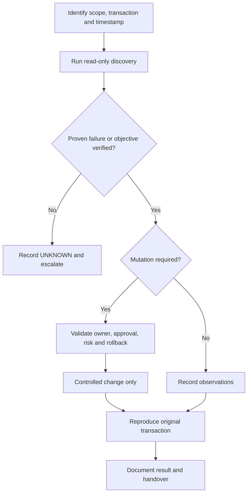

# SOP-REC-001 · RHOSO Control Plane Backup Readiness

> [!WARNING]
> **DRAFT — NOT APPROVED FOR LIVE PRODUCTION.** Release-dependent commands require target-environment verification. **No production execution has been performed.**

| Document control | Value | Document control | Value |
| :--- | :--- | :--- | :--- |
| **SOP ID** | SOP-REC-001 | **Version** | 0.2.0 |
| **Status** | DRAFT | **Type** | recovery |
| **Release** | RHOSO 18.x (micro-release unverified) | **Owner / Approver** | Not assigned |
| **Last live validation** | Not performed | **Execution** | [OCP] / [OS] as marked |
| **Change reference** | Required for any write | **Authoritative owner** | Discover Operator / GitOps / Helm |

**Quick navigation:** [Purpose](#1-purpose) · [Scope](#2-scope) · [Prerequisites](#3-prerequisites) · [Risks](#4-impact-and-risks) · [Flow](#5-decision-path) · [Steps](#6-detailed-procedure) · [Validation](#7-validation) · [Rollback](#8-rollback--recovery) · [Troubleshooting](#9-troubleshooting-and-escalation) · [References](#10-references) · [History](#11-revision-history)

## 1. Purpose

Inventory deployed OADP/Velero protection and determine whether current backup evidence supports RPO/RTO objectives.

**Expected operational outcome:** Recent supported backup, independent storage artifact/integrity checks and documented isolated restore test; backup CR existence alone is insufficient.

## 2. Scope

RHOSO 18.x only with deployed, supported components. Reference names and namespaces are **not** assumed. See the site-specific support matrix before performing changes.

## 3. Prerequisites

Authenticated [OCP] OpenShift workstation and discovered [OS] OpenStackClient when needed; least-privilege credentials; correct cloud/project/region/host; incident or approved change ticket; known authoritative owner.

## 4. Impact and risks

> [!CAUTION]
> Read-only assessment; avoid backup content, credentials and any restore/delete action. Unsupported versions must not be treated as ready. **STOP** if the original transaction, command context, controller ownership, prerequisites or rollback capability is unknown.

## 5. Decision path

## 6. Detailed procedure

| Step | Description | Exact command and context | Expected result | Interpretation / stop |
| :--- | :--- | :--- | :--- | :--- |
| 1 | Check version and context | `[OCP] oc get clusterversion` | Observed OpenShift release | Verify RHOSO/OpenShift/OADP compatibility |
| 2 | Discover backup APIs | `[OCP] oc api-resources \| grep -Ei 'velero\|dataprotectionapplication\|volumesnapshot'` | APIs present or unavailable | Never assume OADP installed |
| 3 | Inspect backup inventory when installed | `[OCP] oc get backups.velero.io -A` | Backup phase/timestamps | Does not establish recoverability |
| 4 | Review storage locations when installed | `[OCP] oc get backupstoragelocations.velero.io -A` | Configured target and phase | Independently verify access and data integrity |

> [!NOTE]
> Run commands **individually in their stated execution context**. Substitute real discovered values. The matrix above is a reference; do not execute a table directly.

### Full procedure and environment discovery

| Field | Value |
| --- | --- |
| Status / version | DRAFT / 0.1.0 |
| Scope | RHOSO control-plane state, OADP/Velero when supported and deployed |
| Execution | [OCP] authenticated admin workstation |
| Owner / approver | To be assigned |
| Last site validation | Not performed |

## Purpose and release gate

**Transaction:** administrator inspects whether configured, recent backup artifacts are ready to support a **documented recovery objective**. This is a read-only readiness review, not a backup/restore execution or proof of recoverability.

The original RHOSO 18.x reference identifies version prerequisites for the OADP method (RHOSO 18.0.21+, OpenShift 4.20+, OADP 1.5+). Recheck current Red Hat support, exact RHOSO maintenance release, OpenShift/OADP versions, storage-backup method and cluster topology before approving this SOP. External Ceph, ODF, database and EDPM configuration protection may need separate procedures.

## Read-only inventory (execute only for installed APIs)

~~~bash
# [OCP][RO] Confirm cluster identity, versions and RHOSO CR namespace.
oc whoami
oc get clusterversion
oc get openstackcontrolplanes -A
oc get openstackdataplanenodesets -A
oc get openstackdataplanedeployments -A

# [OCP][RO] Detect relevant APIs; absence is UNAVAILABLE, not HEALTHY.
oc api-resources | grep -Ei 'dataprotectionapplication|backupstoragelocation|velero|volumesnapshot'

# [OCP][RO] If DataProtectionApplication CRD is installed:
oc get dataprotectionapplications.oadp.openshift.io -A

# [OCP][RO] If Velero API CRDs are installed:
oc get backupstoragelocations.velero.io -A
oc get backups.velero.io -A
oc get schedules.velero.io -A
oc get restores.velero.io -A

# [OCP][RO] If VolumeSnapshot CRD is installed:
oc get volumesnapshots.snapshot.storage.k8s.io -A
~~~

## Acceptance evidence

- RPO, RTO, backup schedule, most recent successful run, age, artifact integrity and retention are documented and approved.
- BackupStorageLocation accessibility, object-store retention, encryption, credential lifecycle and off-cluster availability have been separately verified by authorized operators.
- Database consistency and persistent volume protection are evaluated for the **actual** deployed storage drivers, databases and release.
- A restore exercise was performed in an isolated, supported test environment, or **recovery remains UNVERIFIED**. Listing a completed Backup CR is not a restore test.
- Redacted references and gaps are recorded; secrets or raw backup archives are never committed to git.

## Stop and escalation

Do not generate or run restore/delete commands as part of this SOP. If release support, storage integrity, restore isolation, backup freshness or authoritative configuration is unknown, mark **UNAVAILABLE/WARN** and escalate to the DR owner. Follow release-specific Red Hat restore documentation and a separately approved, exercised DR plan.

References: [RHOSO administration documentation](../../docs/official-sources.md) and [recovery command reference](../../docs/18-backup-disaster-recovery.md).

## 7. Validation

Recent supported backup, independent storage artifact/integrity checks and documented isolated restore test; backup CR existence alone is insufficient. Record observed values, timestamp, request/VM/host reference, and explicit PASS / FAIL / UNAVAILABLE; a healthy Kubernetes object is not an end-to-end test.

## 8. Rollback / recovery

No mutation; rollback not applicable. Restore commands intentionally omitted.

## 9. Troubleshooting and escalation

Classify evidence into **PROVEN HEALTHY**, **PROVEN BROKEN**, **INFERENCE**, **HYPOTHESIS**, and **UNKNOWN**. Record the first proven boundary; do not infer trigger/root cause from labels without logs.

## 10. References

- [RHOSO 18.x admin command reference](../../docs/00-usage-and-conventions.md)
- [Official Red Hat sources](../../docs/official-sources.md)
- [Worked example for this area](EXAMPLE.md) (**SIMULATED**, not observed)

## 11. Revision history

| Version | Date (UTC) | Change | Site verification |
| :--- | :--- | :--- | :--- |
| 0.1.0 | 2026-10-20 | Starter draft | Not performed |
| 0.2.0 | 2026-10-21 | Visual SOP metadata, step/expected matrices and example links | Not performed |
