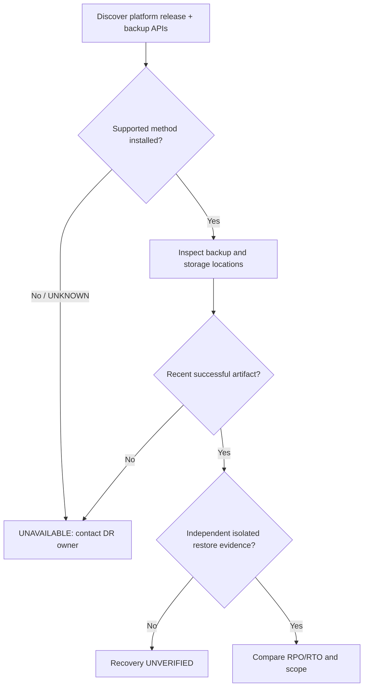

# SOP-REC-001 — RHOSO control-plane backup readiness

!!! warning "DRAFT — read-only audit"
    This SOP does **not** execute backups, restores or deletions. Backup object existence is not proof of recoverability; no site-specific DR validation or approver has been recorded.

| Control | Value | Control | Value |
| --- | --- | --- | --- |
| SOP ID | SOP-REC-001 | Version | 0.3.0 |
| Status | **DRAFT** | Level | L1 inventory; L2 storage; L3 DR |
| RHOSO release | 18.x — exact version **UNKNOWN** | Owner / approver | **Unassigned** |
| Last live validation | **Not performed** | Change | None (read-only) |

## 1. Purpose and acceptance

Evaluate whether configured backups are recent and whether there is **independent, documented restore evidence** meeting the organization's RPO and RTO. A completed Velero Backup or a Bound PVC alone does not establish recovery viability.

## 2. Scope and execution context

[OCP] authenticated admin workstation. OADP/Velero and VolumeSnapshot APIs are **optional**; inspect only if installed. External Ceph/ODF, MariaDB/Galera data and EDPM host configurations may require separately managed protection.

## 3. Preconditions

- Identify RHOSO and OpenShift exact versions, OADP/operator version and supported backup topology. The original RHOSO 18.0 OADP procedure has maintenance-release prerequisites; verify current documentation before relying on it.
- Approved access to backup CRs without disclosing credentials.
- Defined recovery objectives, off-cluster storage owner, last authorized isolated restore test and change authority for any eventual DR exercise.

## 4. Impact and stop conditions

!!! danger "STOP"
    No restore, backup deletion, namespace replacement or storage manipulation from this page. If compatibility, artifact integrity, backup scope, or isolated restore evidence is unknown, report **UNVERIFIED** and escalate to the DR owner.

## 5. Decision path



## 6. Procedure

**Step 1 — Inspect platform and backup API discovery [OCP, read-only].**

```bash
oc whoami
oc get clusterversion
oc get openstackcontrolplanes -A
oc api-resources | grep -Ei 'velero|dataprotectionapplication|volumesnapshot'
```

**Expected:** actual compatible APIs or documented absence. `grep` can exit 1 if no optional resources: classify **UNAVAILABLE**, not an infrastructure failure.

**Step 2 — If applicable CRDs exist, inspect backup resources [OCP, read-only].**

```bash
oc get dataprotectionapplications.oadp.openshift.io -A
oc get backupstoragelocations.velero.io -A
oc get backups.velero.io -A
oc get schedules.velero.io -A
oc get volumesnapshots.snapshot.storage.k8s.io -A
```

**Expected:** inventory and reported phase. Execute only commands whose API exists; failures from missing optional CRDs do not imply backup failure.

**Step 3 — Review recovery acceptance evidence.** Obtain the actual latest artifact, retention, off-cluster access, encryption controls, database/PVC consistency guarantees and last supported **isolated restore test** from the authorized storage/DR owner. Do not retrieve backup data or secrets into the runbook.

## 7. Validation

Record backup age versus RPO, test restore time versus RTO, resources restored (including DB/PVC where applicable), date, storage backend and secure ticket reference. If no isolated restore passed, the result is **UNVERIFIED**; do not mark PASS.

## 8. Rollback

Read-only; none. Actual DR restoration requires an independently approved, supported, exercised procedure including fencing and data consistency safeguards.

## 9. Evidence and escalation

**PROVEN HEALTHY:** backup/storage/restore checks supported by redacted test evidence. **PROVEN BROKEN:** a backed-up dependency or supported restore test failed. **INFERENCE:** recovery impact. **HYPOTHESIS:** specific storage/DB cause without logs. **UNKNOWN:** absent test or inaccessible storage evidence. Escalate to DR/DBA/storage owners.

## 10. References

- [RHOSO backup/restore](https://docs.redhat.com/en/documentation/red_hat_openstack_services_on_openshift/18.0/html/backing_up_and_restoring_a_rhoso_control_plane)
- [Worked example](EXAMPLE.md) — simulated
- [Release gate](../RELEASE-GATE.md) · [Escalation](../START-HERE.md)

## 11. Revision history

| Version | Date (UTC) | Description | Live validation |
| --- | --- | --- | --- |
| 0.1.0 | 2026-10-20 | Initial draft | None |
| 0.2.0 | 2026-10-21 | Visual format | None |
| 0.3.0 | 2026-10-22 | Consistent metadata, version gate, restore acceptance | None |
