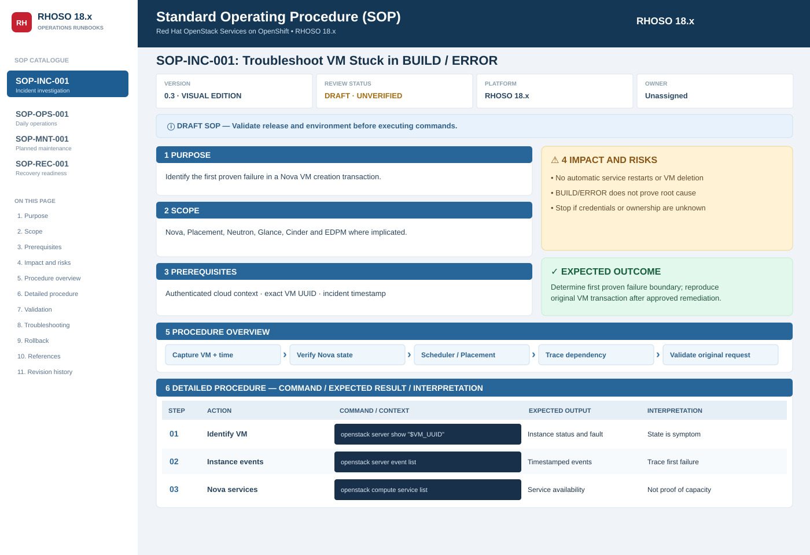

# RHOSO SOP Visual Viewer

This is an **actual rendered HTML/CSS SOP interface**, not a Markdown-only draft. It follows the proposed presentation: a persistent left navigation, RHOSO header, document control grid, purpose/scope/prerequisite cards, warning and success panels, numbered command/expected/interpretation matrix, validation, troubleshooting, rollback, references and revision history.

> **Important:** The SVG above is a **schematic thumbnail** of the design. The real interactive viewer is [index.html](index.html). GitHub displays HTML **source code** in its repository viewer rather than rendering it as a web app.

## Updating the styled content

Follow [the SOP maintainer procedure](../MAINTAINING-SOPS.md), especially **section 3**. Updating `SOP/*.md` does not change this viewer automatically. Edit the corresponding entry in `const docs = {` in `SOP/visual/index.html`; copy it unchanged to `docs/sop/index.html`; compare the visual content against the Markdown authority and test locally. GitHub Actions checks byte equality and syntax, **not semantic consistency**.

## Open the styled SOP

1. Open [index.html](index.html) in GitHub.
2. Select **Download raw file** (or download the file directly from the repository).
3. Open the downloaded `index.html` in Chrome, Edge or Firefox. No build tools, JavaScript dependencies, servers, logins or external assets are needed.
4. Use the left navigation to switch **Incident / Operations / Maintenance / Recovery** procedures. Use the Print / PDF button for a print-friendly handover.

For repository-hosted rendering, the same standalone page is mirrored at [docs/sop/index.html](../../docs/sop/index.html). An administrator can later enable GitHub Pages from the **main** branch's **/docs** folder, which would serve this page under `/RHOSO/sop/`. **GitHub Pages has not been configured or verified by this change.**

## Engineering boundaries

- This is **version 0.3.0 DRAFT**, not an approved site-validated RHOSO runbook.
- HTML display examples are illustrative; the [Markdown SOP documents](../README.md) retain the complete procedure and are the authoritative review/approval location until a reviewed content-generation pipeline is introduced.
- The viewer performs **no infrastructure actions**, API calls, credential reads, network requests or automatic recovery.
- Example results are explicitly **SIMULATED**. Do not conflate user-interface tests with real RHOSO command validation.
- State-changing commands shown in maintenance examples require an approved change, source-of-truth ownership, impact analysis, rollback, and reproduction of the original workload transaction.

## Visual and structural checks performed

- Headless Chromium rendered the desktop layout and a 390px mobile layout.
- All four category selectors displayed the intended SOP; each has five code sections and 11 navigation anchors.
- Verified required panels, warning labels, expected-outcome and validation sections.
- Verified no JavaScript page errors and no viewport-wide horizontal overflow across 1600px, 1280px, 768px and 390px.
- GitHub Actions includes an HTML/JS static check; the browser-based checks above are local, not continuous CI.

See the [core SOP template](../TEMPLATE.md), [review process](../CONTRIBUTING.md), and [official sources](../../docs/official-sources.md).